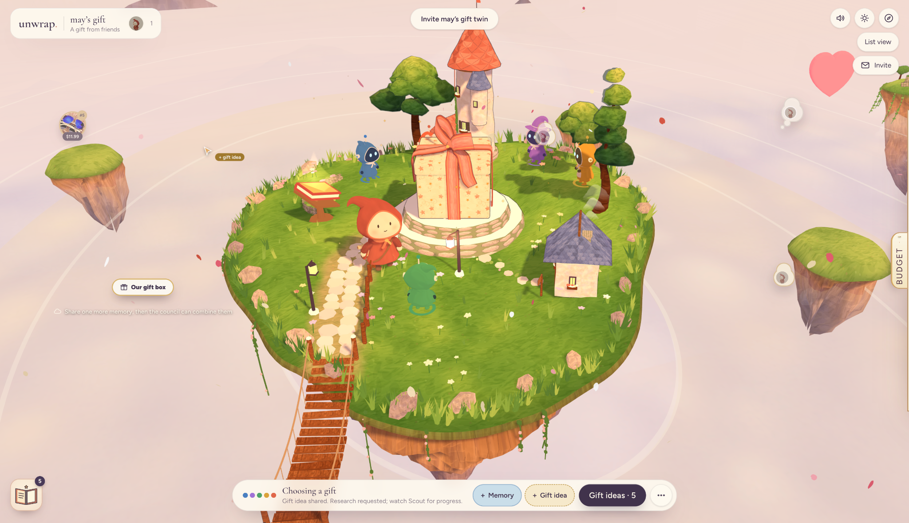
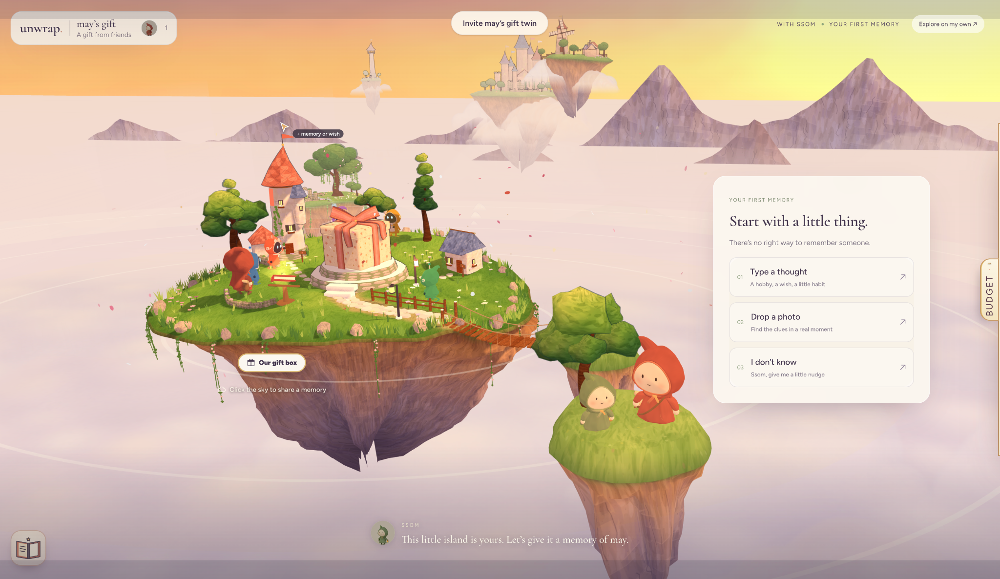
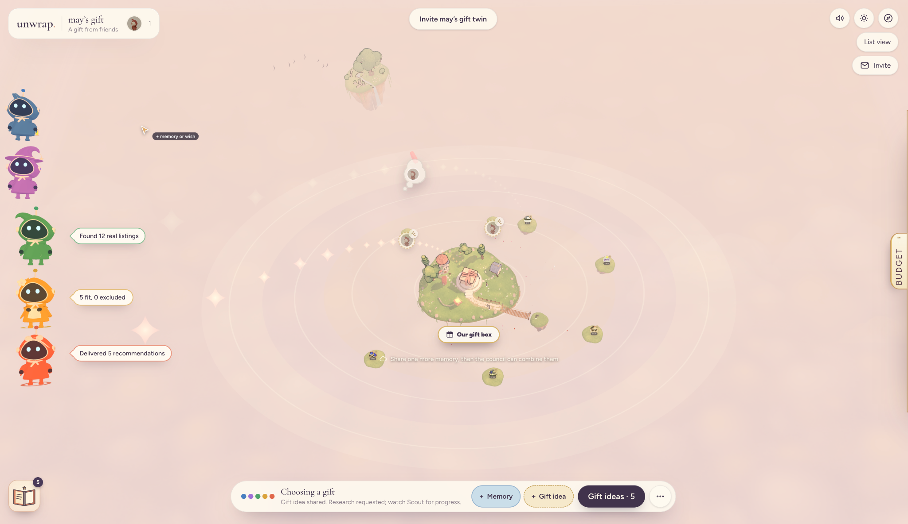
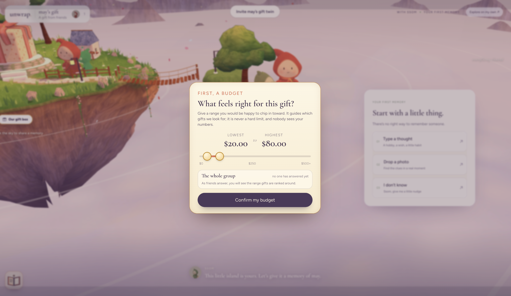
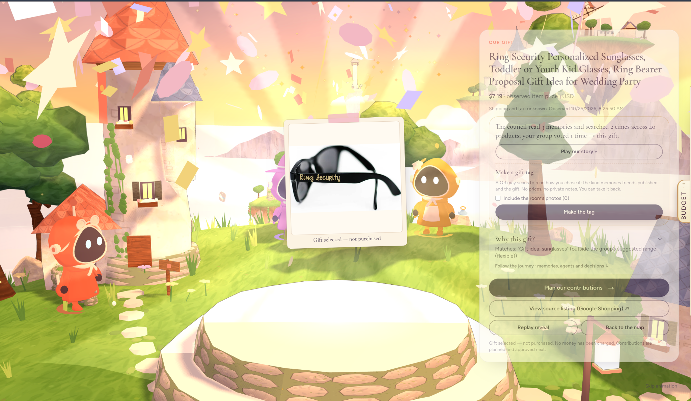
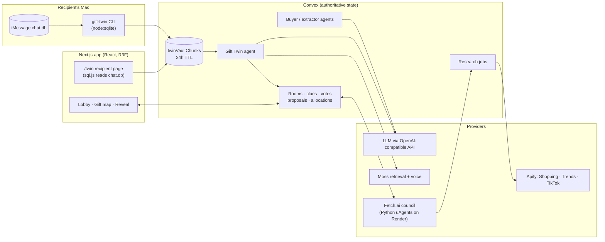
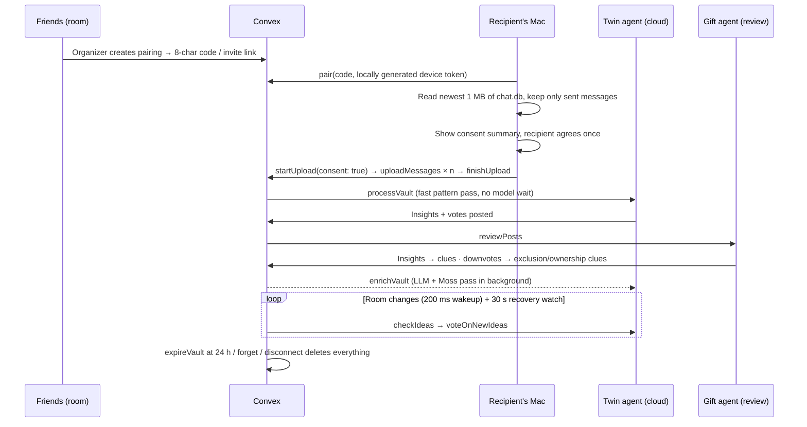

# Unwrap 🎁

### Everyone knows a different side of someone. Together, you know what makes them special.

**Unwrap is a multiplayer, AI-powered gift-discovery experience that brings everyone's memories together to find a more personal gift.**

One friend remembers the hobby they picked up last month. Another knows what they already own. Someone else remembers an offhand wish they mentioned once. Individually, these fragments are easy to overlook; together, they reveal what would make a gift meaningful.

Unwrap brings those perspectives into a shared, hand-painted 3D storybook world. Friends add memories and ideas, specialized AI agents interpret the clues and research sourced products, and the group explores, compares, and chooses together. With the recipient's explicit permission, an optional **Gift Twin** can surface preferences from messages they sent themselves—without exposing their private conversations to the group.

**Cal Hacks 13.0 · October 2026** · [Devpost submission](https://devpost.com/software/unwrap-y7w16s)


## How it works

1. **Bring everyone together.** Create a gift room and invite friends from their phones using a link or QR code.
2. **Share different sides of the recipient.** Add memories, wishes, photos, and ideas; review any AI-suggested clues before publishing.
3. **Connect the clues.** The AI Council interprets shared knowledge and researches sourced gift options. The optional consent-based Gift Twin can add another perspective from the recipient's own sent messages.
4. **Explore and compare.** Discover relationships in the floating-island map, then open the Book of Possibilities to browse products in one place.
5. **Decide together.** Select a gift, set private contribution limits, approve the proposal, and celebrate the group decision through an animated finale.

## Visual language

The experience begins with a **pencil-drawn scene that fills with watercolor**, then becomes an interactive 3D floating-island world. The same visual treatment returns when opening the gift catalogue.


---

## Key features

### 🪞 Gift Twin — the recipient’s perspective, with permission

The recipient pairs their Mac with a gift room and gives **one-time consent**. A companion reads their local iMessage database, uploads **only the messages they sent** (never anyone else's) to a private vault that self-destructs in 24 hours, and a cloud agent acting on their behalf:

- **Posts gift insights** it finds in their texts. "I've been playing tennis a lot" or "I've been wanting an Arc'teryx jacket" becomes a clue on the map. Non-giftable stuff ("I love dinner", "I just got home") is filtered out.
- **Votes up or down on the friends' ideas**, including ones added after the upload. If friends add "Maya loves backpacking" but she texted "I hate backpacking, never again", the twin downvotes it, and that downvote becomes an *exclusion* clue so the shopping agents steer away.
- **Catches things they already own**, turning those into *ownership* clues so nobody buys a duplicate.

The recipient never sees the room's ideas (voting happens in the cloud), so the surprise survives. Full technical breakdown in [How the Gift Twin works](#how-the-gift-twin-works) below.

### 🗺️ A living storybook world and shared gift map



Friends gather in a lobby in front of a 3D storybook present. When the organizer starts the room, the camera pulls back and a ring-shaped map opens around it: **memories on the outside, themes in the middle, real gifts inside, the box at the center.** Click anywhere to add a memory, message, or photo. Everyone sees each other's named cursors live.

### 🔍 Evidence-backed clues



Contributors can import messages and photos. An AI extractor proposes clues from them, and the contributor **privately reviews** each one before it goes public. Every recommendation can answer "why this?" by lighting the path back to the memories it came from.

### 🛍️ Real products, not hallucinated ones
Product research runs through Apify's Google Shopping scraper. Listings carry a source link, an observed price (or an honest "price not observed"), and a retrieval timestamp. The language model **never invents products, links, or prices**. Google Trends and public TikTok search add optional inspiration clouds, clearly labelled as inspiration rather than facts.

### 🤖 The Fetch.ai Gift Council



Five Fetch.ai uAgents (Courier, Archivist, Muse, Scout, Keeper) coordinate over typed messages to research gifts, enforce budgets, and drop anything the person owns or dislikes. The council is also reachable directly in [ASI:One](https://asi1.ai/ai/agent1q2vtalfkht476sacz6v3aslhas7pflw73m9lcpf64cth8vza3j52xtnq5mg). Their progress animates 3D council characters on the map.

### 🗳️ Steering, budgets, and proposals



Drag ideas toward the box to support them, away to pass. Everyone sets a **private contribution limit**, and Unwrap allocates shares deterministically. If the gift, total, or anyone's share changes, the old proposal is invalidated and the group approves a fresh one. An AI can suggest, but **only people select and approve**, and no agent ever touches money.

### 🌿 Moss, the room guide
A narrator character that nudges the group when they're stuck ("does anyone know what she's been into lately?"). It uses Moss semantic retrieval to pick the most relevant prompt, an optional live voice call via the Moss voice platform, and ElevenLabs for narration (falling back to the browser's voice).

### 📖 The Book of Possibilities

A sketch-to-watercolor storybook catalogue gathers researched listings in one place. Friends can inspect actual product links and observed prices, save or pass on options, and follow the supporting memories behind a recommendation. The organizer can then select the gift without navigating every island individually.

### 🎁 The reveal and the gift tag



At the end, a short storybook replays what the room did: memories shared, words that came up most, the council's searches, the votes, then the gift. The organizer can opt into a **gift tag**: a QR code and link the recipient opens without signing in, showing a curated, private-detail-free version of the story.

---

## How we used the technology

Our integrations serve distinct parts of the same collaborative process rather than existing as disconnected API demos:

| Technology | Role in Unwrap | Technical implementation |
| --- | --- | --- |
| **Fetch.ai / Agentverse / ASI:One** | Coordinate specialized agents working on different parts of a gift recommendation | Five Python uAgents exchange typed requests; Courier dispatches Archivist, Muse, Scout and Keeper, while task events feed the live Council characters. The public Courier is accessible through ASI:One. |
| **Convex** | Keep everyone in the same room and enforce decisions safely | Reactive queries, authorized mutations/actions, background scheduling, and stored room state connect phones, desktop, research, votes, private caps, and revision-specific approvals. |
| **Apify** | Ground recommendations in actual product research | The Scout/research pipeline retrieves shopping results; normalization preserves source URLs, observed or unknown prices, and retrieval timestamps. Trends and TikTok can provide separately labeled inspiration. |
| **Moss** | Recall relevant preferences beyond literal keyword matches | Optional isolated semantic retrieval helps Gift Twin compare messages with ideas such as “wheel throwing” versus “ceramics workshop”; Moss also supports optional room guidance/voice workflows. |
| **React Three Fiber / Three.js** | Make memory relationships explorable | A painterly interactive world represents shared themes, evidence paths, Council activity, and the gift-convergence sequence rather than a flat list of suggestions. |
| **Zod / deterministic Convex logic** | Maintain trust at system boundaries | AI suggestions are schema-validated, privacy rules are enforced server-side, and financial shares/approval revision checks are computed without LLM authority. |

## Architecture



**For shared application state, the browser uses Convex.** Convex owns membership, clues, themes, listings, votes, caps, proposals, and job status. Model and product-research jobs run through server-side integrations; the separate Python Fetch.ai service exchanges authorized requests and events with the backend. Optional voice and Council-start endpoints also use Next.js server routes. The map's ring layout is computed in the browser from Convex state and is presentation only. Solo mode is just a one-person room.

Every model output is re-validated with **Zod** before it touches the database. Prompts are never treated as the security control.

---

## How the Gift Twin works



### 1. Reading the messages (on the recipient's machine)

There are two ways in, and both share the same upload pipeline:

- **CLI** (`gift-twin/`): a dependency-free Node 23.6+ script. `src/imessage.ts` opens `~/Library/Messages/chat.db` read-only with built-in `node:sqlite`, streams rows newest-first by `ROWID`, and stops at a **1 MB content budget**. Reactions and tapbacks are skipped (`associated_message_type = 0`). When the plain `text` column is empty, it decodes Apple's `attributedBody` typedstream blob. Each message is capped at 2,000 characters.
- **Browser** (`/twin`): for recipients who don't want a terminal. They pick their `chat.db` in a file picker and a locally bundled **SQLite WASM (`sql.js`)** reader runs the same scan in browser memory. The raw database never reaches Next.js or Convex.

`src/upload.ts` then drops every message where `is_from_me` is false. **Other people's messages, phone numbers, emails, chat names, and attachments are never uploaded.** What's left (text and send time) is batched so each Convex document stays under the 1 MiB limit.

### 2. Consent and the vault

`share` prints exactly what will be uploaded, for how long, and who can read it, then asks once. `device.startUpload` refuses outright without `consent: true`. Messages land in `twinVaultChunks`, which **no public or device query can read back**, not even the recipient's own device. Only `internal.giftTwin.agent.*` functions read it. The device authenticates with a bearer token it generates locally; Convex stores only its SHA-256 hash.

The vault is deleted at 24 hours, on `npm run twin -- forget`, when either side disconnects, when a new upload replaces it, and when the room is deleted.

### 3. Finding gift insights (`convex/giftTwin/extract.ts`)

A **deterministic pass runs first** so results show up in well under a second. Regex patterns catch "I want / I've been wanting / I love / I've been playing / my favorite X is…" style statements. Then filters clean the object ("an Arc'teryx jacket lol" → "Arc'teryx jacket") and reject non-gifts: people, meals, chores, weather, school, and so on. Curated hobby, product, and brand lists decide what counts as giftable. One clear mention is enough, and repeat mentions raise confidence.

If an LLM is configured, `enrichVault` then sends batched messages (up to 4 batches of ~24k chars) to the model acting in the `recipient` role for higher-quality extraction. Its output is Zod-validated and screened like everything else.

### 4. Voting on the room's ideas (`convex/giftTwin/vote.ts`)

For each clue, theme, and listing in the room, the twin searches the vault for evidence. Keyword matching with stemming finds candidate messages, then **sentiment patterns** decide the vote: phrases like *hate, can't stand, never again, gave up, allergic* contradict an idea, while *love, obsessed, been playing, can't wait* support it. Negated ideas are handled too ("doesn't like candles" + "I hate candles" is agreement, not a conflict). **No clear evidence means no vote.**

**Moss semantic memory** (`memoryRecall.ts`, `memorySelection.ts`) covers what keywords miss. "Ceramics workshop" can match "I'd love to learn wheel throwing" with zero word overlap. Each evaluation builds an isolated in-memory Moss index over at most 256 messages (prioritizing gift-relevant ones), queries it, and closes it. Nothing is pushed to a cloud index or saved to disk. Keyword hits are kept alongside so ownership and contradiction evidence isn't lost.

The twin stays live while the vault is open. New memories, themes, or listings wake it after **200 ms**, and a 30-second watch loop on the Convex scheduler catches anything missed.

### 5. The gift agent decides what becomes room knowledge (`convex/giftTwin/review.ts`)

- **Insights** with medium or high confidence are published as clues on the map.
- **Downvotes** become `exclusion` clues ("she dislikes it") or `ownership` clues ("she already has it"). The friend's original clue is left untouched.
- **Upvotes** show up as green "Supports" badges on the idea.
- The gift agent's model can only **veto**, never add. Clues are attributed to the friend who invited the twin, and they can withdraw them.

### 6. Privacy guardrails

| Data | Lives in | Who can see it |
| --- | --- | --- |
| Full iMessage history | Recipient's Mac only | The local companion process |
| Others' messages, contacts, attachments | Never uploaded | Nobody |
| Recipient's sent messages | Convex vault, ≤ 24 h | Only the twin agent's internal functions (and the model provider during its calls) |
| Insights and votes | `agentCollaboratorPosts` | Room members, as screened sentences |

`screenSharedText` rejects quotes, links, contact details, and sensitive topics (health, religion, sexuality, politics, finances, legal, credentials) before anything reaches the room. The twin is a **collaborator, not a participant**: it has no contribution share, can't select or approve, and its votes never count toward participant totals.

---

## The Fetch.ai Gift Council

| Agent | Job |
| --- | --- |
| **Courier** | Public coordinator. Receives the chat, dispatches specialists, writes the answer. |
| **Archivist** | Extracts clues: interests, wishes, owned items, dislikes, budget, occasion. |
| **Muse** | Turns a memory into a symbolic charm for the gift box (pottery → terracotta charm). |
| **Scout** | Runs live shopping search through the Unwrap backend. Keeps only listings with an https link. |
| **Keeper** | Enforces budget, removes owned/disliked items, explains why each pick fits. |

Muse and Scout run in parallel. If a specialist times out, Courier does that step itself, **except research, which it never fakes**. All five run in one uAgents Bureau deployed on Render (`render.yaml`, `fetch-agent/Dockerfile`). Addresses and run instructions are in [fetch-agent/README.md](fetch-agent/README.md).

Try it in ASI:One:
> "Find a birthday gift for Maya. She loves pottery and handmade crafts, already owns a beginner pottery kit, dislikes scented candles, and our budget is $80."

---

## Tech stack

| Layer | Choice |
| --- | --- |
| Frontend | Next.js 16, React 19, TypeScript, Tailwind CSS 4 |
| 3D / motion | React Three Fiber, drei, three.js, Motion |
| Backend & realtime | Convex (queries, mutations, actions, scheduler, file storage), Convex Auth (anonymous) |
| AI | Any OpenAI-compatible Chat Completions model (`LLM_*`), Zod-validated structured outputs |
| Agents | Fetch.ai uAgents (Python), Agentverse, ASI:One |
| Memory & voice | Moss (semantic retrieval + voice agent), LiveKit, ElevenLabs |
| Research | Apify: Google Shopping, Google Trends, TikTok search |
| Message reading | `node:sqlite` (CLI), `sql.js` WASM (browser) |
| Contributions | Convex approval and simulation endpoints; separate Stripe test-mode primitives are not a live checkout |
| Hosting | Vercel (web), Convex Cloud, Render (council) |

---

## Repository layout

```
app/                  Next.js routes
  room/[roomId]/      The gift room, plus /phone, /twin, /map views
  twin/               Recipient's Gift Twin page (consent + chat.db picker)
  join/[token]/       Invite links / QR join
  gift/[token]/       Public gift tag the recipient opens
  council/            Standalone AI Council view
  api/                Council runner, Moss voice, twin SQLite asset
components/           UI: world/ (3D island), room/, map/, giftTwin/, council/, finale/ …
convex/               Backend
  schema.ts           All tables
  giftTwin/           Twin pairing, vault, extraction, voting, review, purge
  agents/             Buyer agent, extractor, themes, directions, photo reading
  research/           Shopping, trends, TikTok, normalization, ranking
  payments/           Stripe sandbox state machine and simulation
  moss/               Room guide recall and voice
gift-twin/            Mac companion CLI (pair · share · forget · doctor)
fetch-agent/          Python Fetch.ai council (Courier + 4 specialists)
lib/                  Shared contracts, validation, map/room logic
docs/                 Architecture, privacy, agent, and contract docs
scripts/              Live smoke tests and provider spikes
```

---

## Getting started

### Web app

```bash
npm install
npx convex dev          # first run: log in, link the project, writes .env.local
npx @convex-dev/auth    # once per deployment: anonymous-auth keys
npm run dev             # second terminal → http://localhost:3000
```

Without `NEXT_PUBLIC_CONVEX_URL`, the UI falls back to read-only fixtures, so frontend work doesn't need a deployment.

Server secrets go on the Convex deployment (`npx convex env set …`), never in `NEXT_PUBLIC_` variables. See [.env.example](.env.example) for the full list. The main ones:

| Variable | Enables |
| --- | --- |
| `LLM_BASE_URL`, `LLM_MODEL`, `LLM_API_KEY` | Model-quality extraction, themes, and twin votes (patterns are used without them) |
| `APIFY_TOKEN` | Live product, trend, and TikTok research |
| `GIFT_TWIN_DEMO_ENABLED=true` | Gift Twin pairing |
| `GIFT_TWIN_MOSS_ENABLED`, `MOSS_PROJECT_ID`, `MOSS_PROJECT_KEY` | Semantic memory for the twin |
| `MOSS_VOICE_AGENT_ID`, `ELEVENLABS_API_KEY` | Moss's voice (Next.js server env) |
| `FETCH_AGENT_URL`, `COUNCIL_AGENT_SECRET`, `COUNCIL_INGEST_SECRET` | Fetch.ai council |

### Gift Twin demo

```bash
# On the Convex deployment
npx convex env set GIFT_TWIN_DEMO_ENABLED true
npx convex dev --once

# In the app: open a room, add a few memories, go to /room/<roomId>/twin, invite the twin

# On the recipient's Mac
npm run twin -- pair ABCD2345     # code from the twin page
npm run twin -- share --fixture   # sample messages; drop --fixture for real iMessage
npm run twin -- forget            # delete the vault now
npm run twin -- doctor            # check Full Disk Access
```

Real iMessage access needs Full Disk Access for your terminal (System Settings → Privacy & Security → Full Disk Access). Other flags: `--max-mb`, `--days N`, `--dry-run`. Or skip the CLI and send the recipient the `/twin` link from the room.

### Fetch.ai council

```bash
cd fetch-agent
python3 -m venv .venv && source .venv/bin/activate
pip install -r requirements.txt
cp .env.example .env    # add seeds and credentials
python agent.py
```

### Checks

```bash
npm run typecheck       # app, Convex, and gift-twin
npm test                # Vitest suite
npm run test:twin       # companion unit tests
cd fetch-agent && python -m pytest -q
```

---

## Implementation status

The codebase contains the following capabilities and verification notes:

- **Implemented and tested:** rooms, invites, private evidence and photo review, research normalization, the agent backbone, the council, votes, private limits, allocation, revision-aware approvals, and the Gift Twin pipeline (fixture and synthetic-database tests).
- **Verified live on a dev deployment:** the twin's fast path (first finding ~0.5 s after upload, a vote on a new contradictory idea ~0.8 s), Moss retrieval in the Convex runtime, and one live shopping search with the Scrapewise actor.
- **Not yet verified end to end:** reading real `chat.db` files across macOS versions (the `attributedBody` decoder covers the common layout only), real macOS file selection in the browser flow, the live Moss voice call, and a full two-browser run on one shared deployment.
- **Contribution completion:** the current shared flow records explicit simulated contributions; it does not charge cards or purchase products. Stripe test-mode primitives exist separately but are not a connected real checkout.

---

## Documentation

| Doc | Covers |
| --- | --- |
| [docs/GIFT_TWIN.md](docs/GIFT_TWIN.md) | Gift Twin design, privacy model, Moss memory, production path |
| [docs/ARCHITECTURE.md](docs/ARCHITECTURE.md) | System design and every decision record (D9–D30) |
| [docs/AI_AGENTS.md](docs/AI_AGENTS.md) | Buyer agent, recipient agent, extraction, ranking |
| [docs/FETCH_AI_COUNCIL.md](docs/FETCH_AI_COUNCIL.md) | Running and registering the council |
| [docs/DATA_AND_PRIVACY.md](docs/DATA_AND_PRIVACY.md) | Consent, classification, access control |
| [docs/COMMERCE_AND_PAYMENTS.md](docs/COMMERCE_AND_PAYMENTS.md) | Listings, allocation, proposals, sandbox payments |
| [docs/CONTRACTS.md](docs/CONTRACTS.md) | Shared TypeScript interfaces |
| [docs/PRODUCT.md](docs/PRODUCT.md) | Vision, journeys, scope |
| [AGENTS.md](AGENTS.md) | Rules for humans and coding agents working in this repo |
