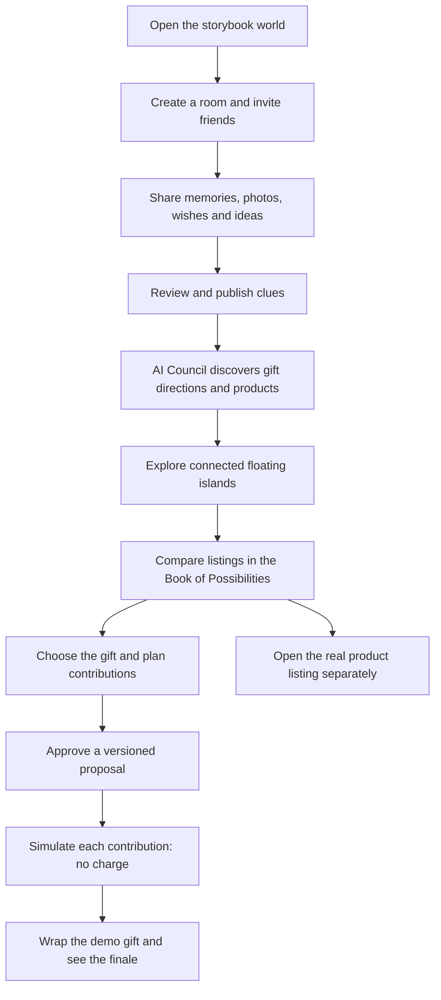

# Unwrap 🎁

**Thoughtful gifts, together.** An interactive storybook world where friends turn shared memories into evidence-backed gift recommendations, agree on a present, and complete a clearly labeled demo gift-wrapping experience.

**Cal Hacks 13.0 · October 2026** · [GitHub repository](https://github.com/Jonjlim/calhacks2026) · [Current `refactor` branch](https://github.com/Jonjlim/calhacks2026/tree/refactor)

> **Codebase snapshot:** This README documents the GitHub **`refactor`** branch (not `refractor`), inspected October 25, 2026. It distinguishes implemented code from optional features and integrations that still require live configuration or validation. **Simulated payments do not charge money, place merchant orders, or buy gifts.**

## What is Unwrap?

Gift ideas often live across group chats, old conversations, half-remembered interests, and one friend's mental list. Unwrap gives those clues a shared place to grow. Friends contribute memories and wishes; an AI Council organizes the clues and researches possible gifts; the group explores the connections in a whimsical floating-island world; and a storybook catalogue makes it easy to compare the real products and choose together.

The product has **two complementary interfaces**: a rich **desktop 3D world** where the group sees their memories and ideas come alive, and a lightweight **phone controller** where individuals join, contribute, and make their own decisions.

## Key features

| Feature | What it does | Main code |
| --- | --- | --- |
| **Living storybook world** | Painterly floating islands, a central floral gift, shifting sky palettes, avatars, camera movement, and cinematic gift transitions. | `components/world/`, `components/intro/`, `components/convergence/` |
| **Real-time collaborative rooms** | Create a room, invite friends with a link or QR code, and synchronize confirmed contributions and decisions through Convex. | `convex/rooms.ts`, `components/room/`, `app/join/` |
| **Memories and clue review** | Contribute memories, messages, ideas, and optional selected media; AI-extracted clues stay private until the contributor reviews and publishes them. | `convex/clues.ts`, `convex/media.ts`, `components/clues/` |
| **Gift Twin — opt-in iMessage insight agent** | With the recipient's explicit permission, a local Mac companion reads a bounded sample of **messages that recipient sent**, extracts gift-relevant interests/wishes/ownership/dislikes, and submits screened insights and advisory votes to the shared gifting process. Not unrestricted scraping. | `gift-twin/`, `convex/giftTwin/` |
| **Five-agent AI Gift Council** | Courier coordinates Archivist, Muse, Scout, and Keeper for clue interpretation, symbolic memory charms, real product research, and budget/constraint checks. Progress events support animated robot statuses. | `fetch-agent/`, `convex/council.ts`, `components/council/` |
| **Evidence-backed gift research** | Associates recommendations with published memories and sourced product listings, including observed prices and product URLs; unknown data stays unknown. | `convex/research/`, `convex/agents/`, `lib/map/` |
| **Interactive gift map** | Visualizes themes, memory connections, gift directions, and selected product candidates in a shared world. | `components/map/`, `components/world/room/GiftRings.tsx` |
| **Book of Possibilities** | Consolidates researched gifts into a readable catalogue with photos, filters, saved/passed decisions, source links, and pencil-to-watercolor opening effects. | `components/book/` |
| **Group gift decisions** | Choose items, vote, set private contribution limits, calculate deterministic shares, and approve a specific proposal revision. | `convex/proposals.ts`, `convex/allocations.ts`, `convex/votes.ts` |
| **Simulated contributions and finale** | Each owing participant simulates their exact share; after all simulations are complete the organizer can wrap the demo gift. | `convex/payments/simulation.ts`, `components/payments/`, `components/finale/` |
| **Optional Moss guide and voice** | Contextual prompts, room-visible recall, and optional narration/voice experiences when configured. | `components/room/useRoomGuide.tsx`, `convex/moss/`, `app/api/moss-voice/` |
| **Shareable gift story** | Renders a gift-story page via a public share token. | `app/gift/[token]/`, `components/story/` |

### The core journey



---

## Spotlight: Gift Twin — personalized gift clues from text messages

**Gift Twin** is the project's optional recipient-side AI collaborator. It is designed to surface the sorts of offhand preferences people mention in everyday conversations—*“I've been playing tennis lately,” “I want to try a pottery class,” “I already own that kit”*—that their friends may have forgotten.

**Technically, this is a local, permission-based iMessage import and AI interpretation pipeline, not a service that silently scrapes anyone's messages.** The current implementation is a **demo**, gated by `GIFT_TWIN_DEMO_ENABLED=true`.

1. **Pair:** The organizer creates a short-lived pairing code for the recipient's Mac. The recipient runs the local `gift-twin` companion and explicitly pairs it to the room.
2. **Read locally:** The companion opens `~/Library/Messages/chat.db` **read-only**, using Node's `node:sqlite`. macOS may require Full Disk Access for the terminal. It reads a bounded recent sample (default **1 MB** of message content).
3. **Minimize before upload:** `gift-twin/src/upload.ts` keeps **only messages sent by the recipient** (`fromMe`), with text and timestamp. It does **not** upload other people's messages, phone numbers, email addresses, chat identifiers, or attachments.
4. **Explicit consent:** After a one-time permission step, selected text is uploaded to an access-restricted Convex vault with a maximum **24-hour lifetime**, or deleted earlier with the forget/disconnect action.
5. **Extract and reason:** Internal Twin actions analyze the permitted text for gift-relevant interests, wishes, dislikes, ownership, and constraints. Optional Moss-based semantic recall can aid finding evidence; model outputs are validated and screened before sharing.
6. **Advise the room:** The Twin posts filtered insights and advisory up/down votes on relevant existing or newly added ideas. The room gift agent reviews proposed insight posts before publishing eligible clues. Confirmed clues and exclusions can influence normal research and ranking.
7. **Protect decisions:** The Twin **cannot** spend money, set contribution limits, approve proposals, choose a gift as a paying member, or access other participants' private payment information. Its votes are advisory, not human votes.

**Gift Twin data path:**

```text
Recipient's Mac (iMessage database, read-only)
   → Local filter: sent-by-me text + timestamp only
   → Explicit consent & one-time pairing
   → Private, expiring Convex message vault
   → Internal AI extraction + evidence review
   → Screened gift insights and advisory votes
   → Published room clues / gift-direction evidence
   → Normal Council research & recommendations
```

The Twin can also evaluate new room ideas while its permitted vault remains active. The vault is intentionally temporary; disabling or revoking the connection stops subsequent use and triggers deletion safeguards. The Twin is **not** general unrestricted access to a person's complete texting history.

**Local companion setup** (recipient's Mac, **Node 23.6+** according to its own README):

```bash
npm run twin -- doctor
npm run twin -- pair <PAIRING_CODE>
npm run twin -- share --fixture    # synthetic test messages
npm run twin -- share              # real permitted messages after consent
npm run twin -- forget             # delete uploaded vault / revoke sharing
npm run test:twin
```

See [`gift-twin/README.md`](gift-twin/README.md) and [`docs/GIFT_TWIN.md`](docs/GIFT_TWIN.md) for privacy boundaries, deployment flags, and the exact workflow.

---

## Technology stack

| Layer | Stack |
| --- | --- |
| Frontend | Next.js 16 App Router, React 19, TypeScript, Tailwind CSS 4 |
| Animation and 3D | Motion, Three.js, React Three Fiber, Drei, custom world geometry/materials, bundled GLBs |
| Alternative graph view | React Flow (`@xyflow/react`) |
| Application backend | Convex real-time queries, mutations, actions, scheduling, file storage, auth |
| AI | Typed/validated model workflows with Zod; Python Fetch.ai `uagents` Council |
| Product research | Normalized sourced research providers (Apify configured for live search) |
| Optional services | Moss, ElevenLabs, LiveKit; Gift Twin Mac companion |
| Payments | Explicit Convex demo simulation; incomplete, dormant Stripe sandbox integration |
| Tests | Vitest, `convex-test`, Node tests, `pytest`, scenario scripts |

Consult [`package.json`](package.json) and [`fetch-agent/requirements.txt`](fetch-agent/requirements.txt) for pinned versions.

## Local development

### 1. Clone the right branch

```bash
git clone https://github.com/Jonjlim/calhacks2026.git
cd calhacks2026
git switch refactor
npm ci
cp .env.example .env.local
```

Use a Node version supported by this project's Next.js release. The separate Gift Twin CLI specifies **Node 23.6+**.

### 2. Start Convex

```bash
npx convex dev
```

Follow the sign-in/linking prompts. The setup normally writes `CONVEX_DEPLOYMENT` and `NEXT_PUBLIC_CONVEX_URL` to `.env.local`.

Anonymous auth requires deployment initialization:

```bash
npm run convex:auth:setup
```

Keep the Convex watcher running. In a second terminal:

```bash
npm run dev
```

Open **http://localhost:3000**.

**Without `NEXT_PUBLIC_CONVEX_URL`**, the app can show read-only preview fixtures. A fixture is not live multiplayer; rooms, invitations, updates, and proposals require Convex.

### 3. Test joining from a phone

Create a real room, then open the generated link/QR from a second device. `localhost` points to each device itself: use a hosted HTTPS URL, accessible tunnel, or reachable local network origin when phones need to join. The phone experience lives at `/room/[roomId]/phone` and deliberately doesn't load the desktop 3D world.

### 4. Optional agent and provider configuration

External AI and shopping are not automatically usable just because the UI renders. Consult [`.env.example`](.env.example), [`docs/FETCH_AI_COUNCIL.md`](docs/FETCH_AI_COUNCIL.md), and [`fetch-agent/.env.example`](fetch-agent/.env.example).

Typical secret/environment names include:

- `LLM_BASE_URL`, `LLM_MODEL`, `LLM_API_KEY` — configured model provider in **Convex**.
- `APIFY_TOKEN` — live sourced product research; configured in **Convex**.
- `FETCH_AGENT_URL`, `COUNCIL_AGENT_SECRET`, `COUNCIL_INGEST_SECRET`, `CONVEX_SITE_URL` — Council integration; environment placement differs across Next.js, Convex, and the Python service.
- `AGENT_SEED`, `ASI1_API_KEY` — Fetch.ai agent service. Keep agent seeds stable to preserve published addresses.
- `GIFT_TWIN_DEMO_ENABLED=true` — optional Convex Gift Twin demo functionality.
- `MOSS_*`, `ELEVENLABS_*` — optional memory/voice/narration integrations.

**Never prefix server secrets with `NEXT_PUBLIC_` or commit them.** Make sure the live Convex site URL, deployed Council endpoint, callback allowlist, and shared secrets point to the **same environment**. A hosted Convex action cannot call an agent running only at your laptop's `127.0.0.1`.

### 5. Optional Fetch.ai Council service

```bash
cd fetch-agent
python3 -m venv .venv
source .venv/bin/activate
pip install -r requirements.txt
cp .env.example .env
# Fill private seed(s), URLs and other required credentials.
python print_addresses.py
python agent.py
```

Run tests with `python -m pytest -q`. Agentverse registration and ASI:One setup are documented at [`docs/FETCH_AI_COUNCIL.md`](docs/FETCH_AI_COUNCIL.md). The repository also includes a Render blueprint for the Council service (`render.yaml`).

## Development commands

| Command | Purpose |
| --- | --- |
| `npm run dev` | Start Next.js development server |
| `npm run dev:convex` | Start Convex development watcher |
| `npm run build` | Production Next.js build |
| `npm run start` | Start built application |
| `npm run typecheck` | Type-check app, Convex, Gift Twin |
| `npm test` | Run Vitest tests |
| `npm run test:twin` | Run Gift Twin Node tests |
| `npm run twin -- doctor` | Diagnose Mac companion setup |
| `npm run agents:smoke` | Opt-in **live** agent smoke test requiring configured services |

Other diagnostic/e2e scripts live in `scripts/`. Inspect their requirements before running; some make real provider calls.

## Main routes

| Route | Responsibility |
| --- | --- |
| `/` | Storybook landing and room entry |
| `/join/[token]` | Invitation link / QR join |
| `/room/[roomId]` | Desktop shared stage, with device-aware routing |
| `/room/[roomId]/phone` | Personal mobile controller |
| `/room/[roomId]/map` | Dedicated/legacy gift map route; main room is map-first |
| `/room/[roomId]/twin` | Optional Gift Twin pairing/studio |
| `/council` | Standalone Council experience |
| `/gift/[token]` | Shared/public gift-story view |
| `/worlds` | World gallery |
| `/demo/group-flow` | Offline shared-decision fixture |
| `/demo/contributions` | Labeled contribution simulation preview |
| `/twin` | Gift Twin entry |

## Architecture overview

```text
Browser (desktop world / phone controller)
   │  Convex auth, subscriptions, calls
   ▼
Convex — authoritative rooms, evidence, clues, products, votes,
         proposals, approvals, and simulated contributions
   ├── agent and extraction workflows → configured model
   ├── researched listings and ranking → configured sources
   ├── Council events ↔ Fetch.ai uAgents service
   └── Optional Gift Twin vault/internal recipient collaborator
                       ▲
                       │ explicit consent, device pairing
                Recipient's Mac CLI
```

**Key boundaries:** Convex enforces membership and privacy; the AI doesn't approve money, invent listings, or publish private evidence without required review. Product records retain actual source URLs and observation times. Financial amounts use integer USD cents and deterministic allocation, not model estimates.

### Major subsystems

- **Rooms and auth:** `convex/rooms.ts`, `convex/auth.ts`, `components/providers/`, `components/room/RoomScreen.tsx`.
- **Desktop and mobile presentation:** `components/room/RoomLayout.tsx`, `components/participant/MobileParticipantExperience.tsx`, `lib/room/surface.ts`.
- **World and camera:** `components/world/`, including `WorldCamera.tsx`, `AtmosphericSky.tsx`, `IslandEnvironment.tsx`, painterly materials, island props, gift interactions, and animated agents.
- **Clues, photos, messages:** `convex/clues.ts`, `convex/media.ts`, `convex/messages.ts`, `components/clues/`.
- **Gift research:** `convex/agents/`, `convex/research/`, `convex/map.ts`, `lib/map/`.
- **Council:** `fetch-agent/council/`, `convex/council.ts`, `convex/councilRoom.ts`, `components/council/`.
- **Book of Possibilities:** `components/book/BookOfPossibilities.tsx`, `BookCorner.tsx`, `bookStore.ts`, `book.module.css`.
- **Decisions:** `convex/proposals.ts`, `convex/allocations.ts`, `convex/votes.ts`, `components/proposal/`.
- **Convergence/finale:** `components/convergence/`, `components/world/convergence/`, `components/finale/`, `components/story/`.
- **Simulation:** `convex/payments/simulation.ts`, `components/payments/ConnectedContributionSimulation.tsx`.
- **Gift Twin:** `gift-twin/src/imessage.ts`, `gift-twin/src/upload.ts`, `convex/giftTwin/agent.ts`, `convex/giftTwin/device.ts`, `convex/giftTwin/review.ts`.
- **Optional Moss:** `convex/moss/`, `components/room/useRoomGuide.tsx`, `app/api/moss-voice/`.

## Repository layout

```text
app/                 Next.js routes and API endpoints
components/
  book/              Interactive catalogue and book animation
  council/           AI Council scene, avatars and event UI
  convergence/       Memory/gift convergence timing and effects
  finale/            Simulated contributions and final wrapping
  giftTwin/          Recipient companion UI
  intro/             Illustrated opening
  map/               Map, product and memory visualization
  participant/       Mobile controller
  payments/          Simulation frontend
  room/              Stage, guidance, contribution UI
  story/             Public gift story
  world/             Three.js environment, gift, agents, shaders, islands
convex/
  agents/            Interpretation and agent workflows
  giftTwin/          Recipient-authorized vault and agent processing
  moss/              Optional room memory/retrieval
  payments/          Demo simulation and sandbox building blocks
  research/          Provider integrations and scored listings
fetch-agent/         Python uAgents coordinator and specialists
gift-twin/           Recipient Mac companion CLI
lib/                 Shared contracts, policies and utilities
public/              GLB assets, portraits, sounds
scripts/             E2E, tests, experiments, rehearsal
work/                Visual prototypes, reviews, recorded evidence
docs/                Specifications and subsystem handoffs
```

`work/` includes experimental studies and past screenshots. Their presence doesn't prove a component is mounted in the primary application; follow imports from `app/` when determining what is live.

## Contributions, approvals and payment transparency

For the actual gift box, contributions use **private limits** and a deterministic allocation algorithm. Members approve their current shares and the exact gift/estimated total. Any change to the proposal revision invalidates previous approval where applicable.

The **demo** uses `convex/payments/simulation.ts` to record each owing participant's simulated completion. Only after all required simulations finish may the organizer trigger wrapping. These actions **do not call Stripe**.

The repository also has test-mode Stripe transport, reconciliation, payment-state code, and webhook helpers in `convex/payments/`. Per [`convex/payments/README.md`](convex/payments/README.md), this is **not a fully integrated, enabled real checkout**. Do not describe it as available payment processing. Unknown shipping and tax remain explicitly unknown; the real listing must be opened separately if the group wants to buy the item.

## Privacy and security

- Private conversation imports and proposed clues remain contributor-only until approved for publication.
- Recipient Gift Twin uploads happen only with explicit permission and are limited to **the recipient's own sent text**; other participants do not receive raw imported messages.
- The Twin vault expires after at most 24 hours and can be deleted earlier.
- AI-generated insights are screened and revalidated; a model isn't an access-control layer.
- Other people's private contribution limits aren't exposed as shared room data.
- AI cannot approve proposals, charge money, or make merchant purchases.
- Product links, prices and retrieval timestamps are derived from records, not invented by the model.
- Server secrets belong in protected environments, never frontend bundles.

See [`docs/DATA_AND_PRIVACY.md`](docs/DATA_AND_PRIVACY.md), [`docs/CONTRACTS.md`](docs/CONTRACTS.md), and [`AGENTS.md`](AGENTS.md).

## Current implementation and known limitations

This README is grounded in the **code visible on `refactor`**, not a fresh production smoke test. It confirms that the modules exist and describes their code paths; it does **not** claim that live AI, product search, all animation transitions, mobile QR invitations, and a complete multiplayer demo have all been validated on the same deployment.

The checked-in [`October 25 branch review`](work/branch-review-2026-10-25/REVIEW.md) specifically reports a configuration mismatch/missing live research and Council environment variables on one inspected Convex deployment. Revalidate against the deployment currently used for demos; that observation might have been resolved elsewhere.

Recommended end-to-end checklist:

1. Run `npm run typecheck`, `npm test`, and `npm run build`.
2. Start a Convex-connected room; join from a second browser/phone.
3. Publish a real memory and verify a room-visible update.
4. Run a Council request and inspect the recorded task events.
5. Check that researched listings contain working source links and observed/unknown prices.
6. Inspect all recommendations in the Book of Possibilities; shortlist/pass/select.
7. Enter distinct private caps, calculate shares and collect fresh approvals.
8. Simulate each payer's contribution, wrap, and open the final story.
9. Verify that **no actual payment or merchant order** occurs.
10. Separately test opt-in Gift Twin with fixture messages before using real personal data.

## Further documentation

- [`AGENTS.md`](AGENTS.md) — contributor and agent working rules
- [`docs/PRODUCT.md`](docs/PRODUCT.md) — product vision
- [`docs/ARCHITECTURE.md`](docs/ARCHITECTURE.md) — architecture and decisions
- [`docs/CONTRACTS.md`](docs/CONTRACTS.md) — shared types and data contracts
- [`docs/DATA_AND_PRIVACY.md`](docs/DATA_AND_PRIVACY.md) — consent and authorization
- [`docs/AI_AGENTS.md`](docs/AI_AGENTS.md) — AI agent workflows
- [`docs/FETCH_AI_COUNCIL.md`](docs/FETCH_AI_COUNCIL.md) — Fetch.ai setup and Agentverse integration
- [`fetch-agent/README.md`](fetch-agent/README.md) — specialist agents and local run instructions
- [`docs/GIFT_TWIN.md`](docs/GIFT_TWIN.md) — message-import agent and privacy model
- [`gift-twin/README.md`](gift-twin/README.md) — Mac companion commands
- [`docs/COMMERCE_AND_PAYMENTS.md`](docs/COMMERCE_AND_PAYMENTS.md) — gift proposals and payment boundaries
- [`convex/payments/README.md`](convex/payments/README.md) — simulation vs. unfinished Stripe integration
- [`work/branch-review-2026-10-25/REVIEW.md`](work/branch-review-2026-10-25/REVIEW.md) — historical deployment review

---

*The best gift is the one that says: I remembered.*
