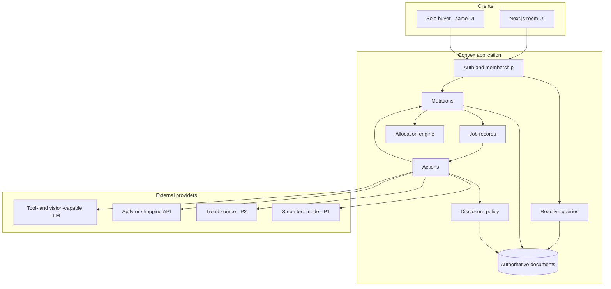
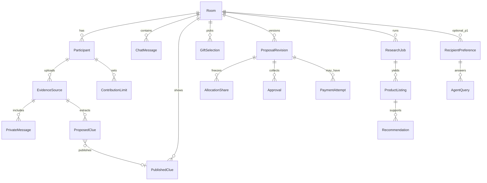
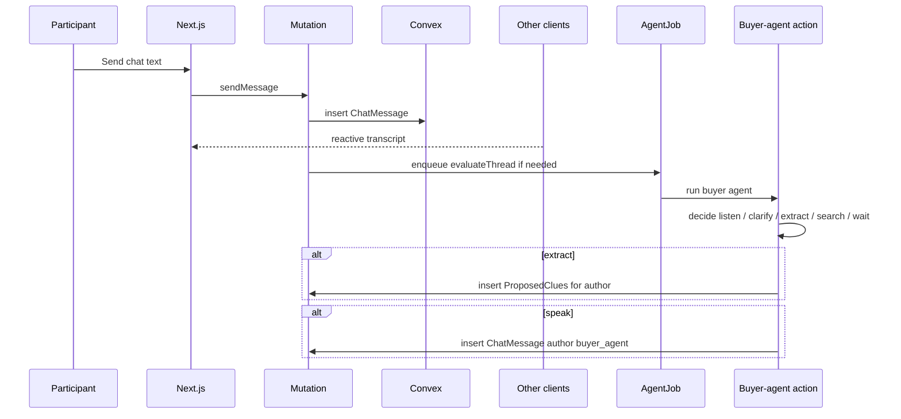

# Architecture

Smallest coherent system that supports the product in [PRODUCT.md](PRODUCT.md): a Next.js client and a Convex backend. External providers are called from Convex actions. There is no second database, no dedicated queue service, and no Python worker in the planned architecture.

[PLAN.md](../PLAN.md) suggested an optional Node worker and a possible Python optimizer. Both are rejected for this weekend unless a spike proves Convex actions cannot call the chosen provider.

## Decisions

### D13 — Public TikTok fashion discovery experiment (2026-10-24)

Dev 4 evaluated `clockworks/tiktok-scraper` build `0.0.620` as a local public fashion-context source. One public style query, at most 20 requested posts, normalized captions/hashtags/URLs/timestamps and engagement snapshots only. No recipient accounts, private messages, profile crawling, downloads, vision provider, or deployed changes. Recent sampled posts are not a platform-wide trend chart; a single engagement snapshot cannot establish growth. Existing shopping remains the only product source. Results: [DEV4_TIKTOK_SPIKE.md](DEV4_TIKTOK_SPIKE.md).

The first source timed out at device registration with zero posts: **no-go for this configuration**. The second candidate, `xmolodtsov/tiktok-search-scraper` build `0.1.39`, returned 19 posts in 11.322s with a global 20-result cap and no expansion pools or author-profile/comment add-ons. Six passed the independent 30-day date check; three creators supported one loose-fit-jeans discovery, which fed 40 shopping results. **Conditional go for local caption-based inspiration; production reliability and platform-wide trend coverage remain unverified.** Regional scope remains unknown. Provider default author metadata is not used for preference inference; normalized observations retain only the minimal documented fields.

### D12 — Local trend discovery experiment (2026-10-24)

Dev 4 evaluated `apify/google-trends-scraper` build `0.0.141` as a public category-context source. This is a standalone script, not a second product catalog or a deployed service. It sends public search terms only, retains source/time-range/geo provenance, and cannot publish clues or change recommendation scores. Existing shopping retrieval remains unchanged. Production integration requires a separate reviewed contract/job change. See [DEV4_TRENDS_SPIKE.md](DEV4_TRENDS_SPIKE.md).

The first candidate timed out with zero completed pages at 180 seconds: **no-go for this configuration**. The second candidate, `agenscrape/google-trends-scraper` build `1.0.21`, passed two live related-search runs (about 14s and 12s; no browser-based topics): **conditional go for local category discovery**, not verified production reliability. One discovered query successfully fed the existing shopping Actor. Both use Apify; neither replaces the product source. Shared additive `TrendContext` / `TrendObservation` types are consumed only by local scripts/tests; no database migration or production scoring change.

### D11 — Photo clues as P0 evidence input (2026-10-24)

Product cards show real source photos (P0). Photo clues (P0), screenshot clues (P1-C), and voice notes (P2) are read once by the vision-capable model into private text or observation rows; the uploaded file is deleted. No face recognition — the uploader taps who the recipient is. Gift choice is visual, and non-text input is the strongest “you remembered” moment, but one clue pipeline with one human gate is easier to secure than three. Rejected: storing raw images or audio; a separate image-clue pipeline; face recognition or identity inference; AI-generated product images. Contracts: “Photo observation” in [CONTRACTS.md](CONTRACTS.md).

### D10 — Bounded research feedback and cached replanning (2026-10-24)

Member 3 and member 4 share one database/catalog projection for ranking and evidence. Each research request captures its requester/message context and at most one persisted continuation pointer. Completion/failure/timeout and continuation scheduling are one transaction. The follow-up is a distinct, version-fenced job; it cannot start research or call another recipient agent. Confirmed knowledge changes can re-evaluate the existing pool after a short debounce, but cannot authorize another paid provider run. Purchase facts in recommendation messages are rendered by application code from current observations, not model prose. Question replies require an explicit slot. No new service/provider is added.

### D9 — Agent backbone implementation (2026-10-24)

Dev 3 implements bounded role handoffs within Convex, using one configurable Chat Completions-compatible model adapter (`LLM_BASE_URL`, `LLM_API_KEY`, `LLM_MODEL`). JSON mode plus strict local Zod validation is used; provider/model support remains **unverified** until a credentialed spike succeeds. No SDK, additional database, or agent service is added. Reference: [JSON mode and structured outputs](https://developers.openai.com/api/docs/guides/structured-outputs?api-mode=chat).

Scheduling and effect commits happen in mutations. An action must claim a pending job; all commits fence on status, attempt, membership, and current input. A watchdog marks abandoned work uncertain. Model retries are bounded; HTTP failures do not expose response bodies or secrets. UI activity is a separate projection of fixed event summaries. Recipient-agent support remains optional, with a server-gated synthetic operator profile, grants, revision-aware revocation, and fixed output guidance. Existing P0 does not depend on it.

| ID | Decision | Rationale | Rejected alternative |
| --- | --- | --- | --- |
| D1 | Unwrap is a collaborative evidence-backed studio. AI improves decisions; it is not decoration. | Matches the pitch and GiftSync chat requirement. | Chat wrapper around a generic recommender. |
| D2 | Differentiation is shared evidence, cited recommendations, revision-aware group decisions, and (later) permissioned recipient knowledge. | Honest vs existing AI gifters. | “World’s first AI gifting app.” |
| D3 | Contributor evidence and recipient-authorized data are separate stores with separate policies. | Required by the two consent flows. | One “user context” blob; prompt-only isolation. |
| D4 | P0 is pledges + approvals. Payments are P1-B. LLMs cannot move money. | Payments are the highest-risk workstream. | Sandbox capture as a P0 dependency. |
| D5 | AI interprets; deterministic code authorizes, allocates, and transitions state. | Money and membership must be testable. | Letting the model emit “approved” or “charge this.” |
| D6 | Price and availability require a source URL and `retrievedAt`. | Judges and buyers must be able to check. | Model-invented products or stale remembered prices. |
| D7 | Contracts first; every workstream mocks the others. | Four people, 36 hours. | Implementing against implicit types. |
| D8 | A working demo beats feature count and sponsor count. | Hackathon scoring happens on what runs. | Building every track integration. |

### Stack evaluation

| Choice | Verdict |
| --- | --- |
| Next.js + React + TS + Tailwind | Confirmed starting point. One app for solo and group. |
| Convex | Confirmed. Authoritative room state, reactive queries, membership. |
| One tool-capable LLM + Zod | Confirmed. Provider and model ID are **unverified** until Phase 0. |
| Apify as first product source | **Conditional go for discovery.** RC-002: `johnvc/google-shopping-api-google-shopping-products-prices-deals`, build `0.0.142`, passed two live searches (40 products each). Links are Google Shopping URLs; direct merchant navigation and final prices remain unverified. Results and limitations: [DEV4_SOURCE_SPIKE.md](DEV4_SOURCE_SPIKE.md). |
| React Flow | Proposed for the map. P0 may ship a simpler graph or list if it threatens the critical path. |
| Motion / CSS | Confirmed for lightweight, state-honest animation. |
| Stripe test mode, manual capture | P1 only. **Unverified** against current sponsor rules. Visa eligibility is not implied by Stripe. |
| Vercel + Convex | Confirmed hosting. No extra worker host in P0. |
| Bitdeer / Factory / Bright Data | Conditional sponsor options. Adopt only after a spike shows a real product role. |
| Convex file storage | P0 (photo clues), P1-C, P2. Holds photos, screenshots, and voice notes until they are read, then deletes them. |
| Vision input on the chosen LLM | P0 (photo clues) and P1-C. **Unverified until the Phase 0 spike.** Must work on the same provider; no second LLM SDK. If it fails, photo clues demote to the text-only spine. |
| Speech-to-text API | P2. **Unverified** new provider. Spike before any code depends on it. |

## Component diagram

Four independently implementable surfaces:

| Surface | Owner | Talks to the others through |
| --- | --- | --- |
| Room UI | Dev 1 | Convex queries/mutations in [CONTRACTS.md](CONTRACTS.md) |
| Schema, membership, proposals | Dev 2 | Document shapes and mutation names |
| Agent actions and tools | Dev 3 | `AgentDecision`, clue payloads, recipient-query API |
| Research + commerce adapter | Dev 4 | `ProductListing`, `ResearchJob`, later `PaymentAttempt` |

## Client / server boundary

The browser never calls the LLM, Apify, or Stripe directly.

- **Queries** return membership-filtered projections. Private imports, unpublished clues, and contribution caps are stripped for non-owners.
- **Mutations** are the only way to change room state. They validate identity, revision, and money.
- **Actions** perform external I/O. They must not be the source of truth; they write back through mutations.

Next.js server components may render public marketing or the reveal page. They still read Convex; they do not keep a parallel store.

## Convex architecture

Use one Convex deployment.

| Mechanism | Use |
| --- | --- |
| Tables + indexes | Rooms, members, messages, clues, listings, jobs, revisions |
| Queries | Chat transcript, published knowledge, shortlist, proposal view |
| Mutations | Send message, publish clue, set cap, select gift, approve |
| Actions | Extract clues, decide whether the agent should speak, search products, query recipient agent, Stripe calls |
| HTTP routes | Stripe webhooks in P1-B only |
| Scheduled functions | Job timeouts and stale-listing refresh, kept minimal |

Authoritative application state lives in Convex documents. Authoritative payment state lives at Stripe. After every provider call, reconcile into our documents. A successful Convex write does not mean Stripe captured, and a browser redirect does not mean payment succeeded.

## Data model

Core entities and owners:

| Entity | Owner | Notes |
| --- | --- | --- |
| `Room` | Dev 2 | Occasion, deadline, `USD`, budget hint, current revision pointer |
| `Participant` | Dev 2 | Identity, role `organizer` \| `contributor` |
| `ChatMessage` | Dev 2 | Human or `buyer_agent` author |
| `EvidenceSource` / `PrivateMessage` | Dev 2 | Contributor-private |
| `ProposedClue` | Dev 2 store / Dev 3 producer | Contributor-private until publish |
| `PublishedClue` | Dev 2 | Room-visible knowledge |
| `RecipientPreference` | Dev 3 | P1-A only; separate consent |
| `ResearchJob` / `ProductListing` / `Recommendation` | Dev 4 | Provenance required |
| `GiftSelection` | Dev 2 | One current selection per room |
| `ContributionLimit` | Dev 2 | Private cap |
| `ProposalRevision` / `AllocationShare` / `Approval` | Dev 2 | Deterministic |
| `PaymentAttempt` / `ProviderEvent` | Dev 2 records / Dev 4 adapter | P1-B |
| `AgentJob` / `AgentDecision` | Dev 3 | Includes listen/wait with no chat reply |

Full field lists: [CONTRACTS.md](CONTRACTS.md).

## Realtime message flow

Deduplicate agent jobs per room with an `inputHash` of `(roomId, lastMessageId, knowledgeRevision)`. A newer message supersedes an in-flight evaluate job; the old job writes `stale` and does not post.

## AI orchestration flow

1. Mutation persists the human event.
2. Mutation inserts `AgentJob` `pending` with the input hash.
3. Action loads **only** the tool-permitted snapshot for the buyer agent.
4. Model returns a structured `AgentDecision`. Zod validates it.
5. Deterministic code executes allowed effects: propose clues, request research, post one chat message, or no-op.
6. Effects that fail authorization are dropped and logged. The model does not retry itself in a loop; the action schedules at most one follow-up if `needsFollowup` is set and a budget remains.

Recipient-agent calls (P1-A) go through the disclosure policy, not through a shared “memory” tool. See [AI_AGENTS.md](AI_AGENTS.md).

## Research and recommendation flow

1. A participant or the buyer agent calls `startResearch`.
2. Mutation writes `ResearchJob` `pending` with the clue IDs, budget, and knowledge revision.
3. Dev 4 action calls the one approved source.
4. Results are normalized to `ProductListing`. Rows without `sourceUrl` + `retrievedAt` are discarded.
5. Scoring reads published clues and listing facts. Trend score is optional and defaults to zero.
6. `Recommendation` rows store ranked candidates plus explanation IDs.
7. If the room’s knowledge revision is newer than the job’s input, the job becomes `stale` and does not overwrite the current shortlist automatically.

## Shared gift state

Each room has at most one `GiftSelection` in `active`. Votes and reactions are advisory. The organizer (or a unanimous rule we can implement quickly) sets the selection.

Changing the selection, the observed payable total, or any allocation input mints a new `ProposalRevision` and sets prior approvals to `invalidated`.

## Proposal revision handling

A revision is immutable. It contains:

- `selectionId`, listing snapshot, quantity
- `payableTotalMinor` and which amount parts are known
- `shares[]` for every participant
- `conditions[]`
- `expiresAt` (optional)

Allowed transitions are in [COMMERCE_AND_PAYMENTS.md](COMMERCE_AND_PAYMENTS.md). Clients cannot patch a frozen revision.

## Authentication and authorization

Decision (Phase 0): Convex Auth (`@convex-dev/auth`) with the anonymous provider. Each browser signs in anonymously; membership is the `Participant` row for that user. A room invite token grants `Participant` membership. The Convex deployment needs `JWT_PRIVATE_KEY`, `JWKS`, and `SITE_URL` (run `npx @convex-dev/auth` once per deployment).

P0 permission choice: any member can start research; only the organizer confirms the selected gift.

Authorization checklist, enforced in mutations/queries:

| Action | Who |
| --- | --- |
| Read chat, published clues, listings, current proposal | Room members |
| Read/write own import, proposed clues, cap | Owning participant |
| Publish a clue | Owning contributor of that proposed clue |
| Start research, select gift | Organizer, or any member if we keep P0 loose — pick one in schema and stick to it. Default: any member can start research; organizer confirms selection |
| Approve revision | Each participant for their own share |
| Read recipient preferences | Recipient-agent tools after policy grant |
| Payment mutations | P1-B, server only |

A room link never authorizes private imports, unpublished clues, contribution caps, or recipient-agent storage.

## Background jobs

Represented as documents, not a separate queue:

- `AgentJob`
- `ResearchJob`
- `PaymentAttempt` (P1)

Each has `status`, `attempt`, `idempotencyKey`, `inputHash`, and `lastError`. Actions are idempotent on `idempotencyKey`. Cap automatic retries at two. Terminal states: `succeeded`, `failed`, `stale`, `canceled`.

## Idempotency and concurrency

- Client mutations that create revisions, jobs, or payment attempts require an idempotency key.
- Optimistic concurrency: mutations that depend on `currentRevisionId` fail with `invalid_revision` if the pointer moved.
- Two clients cannot approve different revisions into one purchase: approval writes check `room.currentRevisionId === approval.revisionId`.
- Capture (P1) flips the room to `capturing` before any Stripe call. Further edits queue as drafts.

## Error handling and recovery

| Failure | Application behavior |
| --- | --- |
| LLM validation failure | Job `failed`; no clues written; UI shows “couldn’t read that yet” |
| Product source timeout | Job `uncertain` then `failed`; keep last good shortlist |
| Stale research | Mark `stale`; do not clobber a newer selection |
| Infeasible allocation | Proposal `infeasible`; no approval collection |
| Provider payment timeout (P1) | Attempt `uncertain`; reconcile from Stripe; UI shows recovery |
| Partial capture (P1) | Stop remaining captures, cancel uncaptured auths, refund if needed, `recovery_pending` |

The UI owns truthful empty, error, and recovery states. See [COMMERCE_AND_PAYMENTS.md](COMMERCE_AND_PAYMENTS.md) for payment recovery invariants taken from [PLAN.md](../PLAN.md).

## Deployment boundaries

| Host | Runs |
| --- | --- |
| Vercel | Next.js UI |
| Convex | DB, reactive sync, actions, (P1) webhook |
| LLM provider | Inference only |
| Apify / shopping API | Retrieval only |
| Stripe | Payment objects (P1) |

No Kubernetes, no extra Redis, no separate auth vendor required for the hackathon.

## Failure recovery (system)

- If Convex is down, the demo is down. There is no offline mode.
- If the LLM is down, chat and manual clue entry still work. Ship a manual “add clue” form as a fallback.
- If the product API is down, show the last retrieved listings with timestamps, labeled as cached, or a fixture set that is **never** presented as live.
- If Stripe is down or the spike fails, P0 pledges remain the product.

## Authority map

| Fact | Authority |
| --- | --- |
| Who is in the room | Convex `Participant` |
| What was said in-room | Convex `ChatMessage` |
| What the group has confirmed | Convex `PublishedClue` |
| What a contributor has not published | Convex `ProposedClue` / `PrivateMessage` |
| What the recipient agent may know | Convex `RecipientPreference` + policy |
| What a product costs right now | External listing at `retrievedAt`; our row is an observation |
| Whether a revision is approved | Convex `Approval` rows |
| Whether money moved | Stripe (P1); otherwise nothing moved |

## Implementation seams for four developers

Dev 1 can build the entire atelier against mock Convex hooks that satisfy the query shapes.

Dev 2 can ship schema, membership, chat, publish, allocation, and revisions with fixture clues and listings.

Dev 3 can run extraction and agent decisions in actions that write the documented payloads, even if the UI is still ugly.

Dev 4 can normalize one live search into `ProductListing` and score against fixture published clues.

Integration checkpoints are in [EXECUTION_PLAN.md](EXECUTION_PLAN.md).

## Dev 4 research integration (RC-004 / RC-006)

The research mutation uses Dev 2's membership and job-insertion helpers. Pure brief/ranking functions are provided by the parallel Dev 4 workstream. Provider start/poll/dataset calls run in Convex actions with APIFY_TOKEN from deployment environment variables. Durable scheduled polls retain provider run IDs; a watchdog marks stranded workers uncertain.

A completion transaction validates current knowledge and request order before writing listings. The recommendations query re-ranks the latest successful candidate pool against current room clues. No extra services or queues are introduced. The existing brief validator remains unchanged: research explicitly stores the brief without duplicated roomId and restores it at the provider boundary.

Local tests mock paid provider traffic. This checkout still needs the team's Convex deployment configuration and its APIFY_TOKEN before a deployed end-to-end test. Do not create a competing team deployment just for Dev 4. Anonymous-auth setup belongs to Dev 2 / frontend integration.
