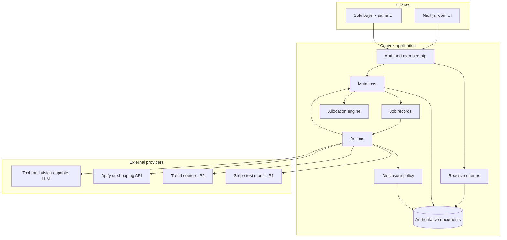
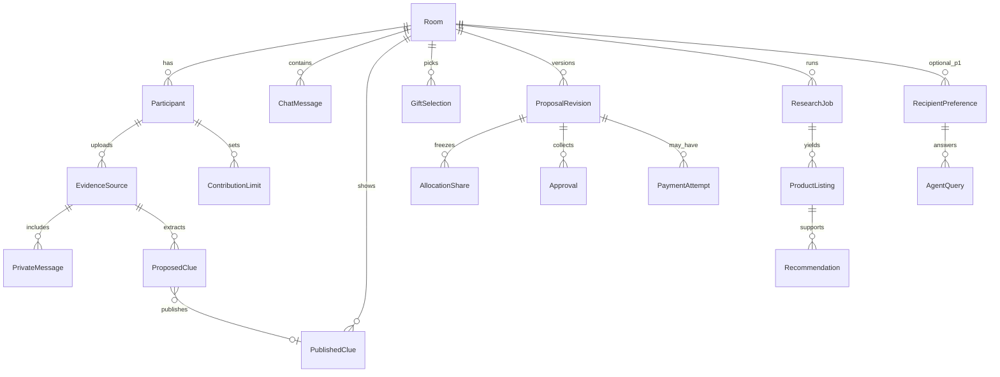
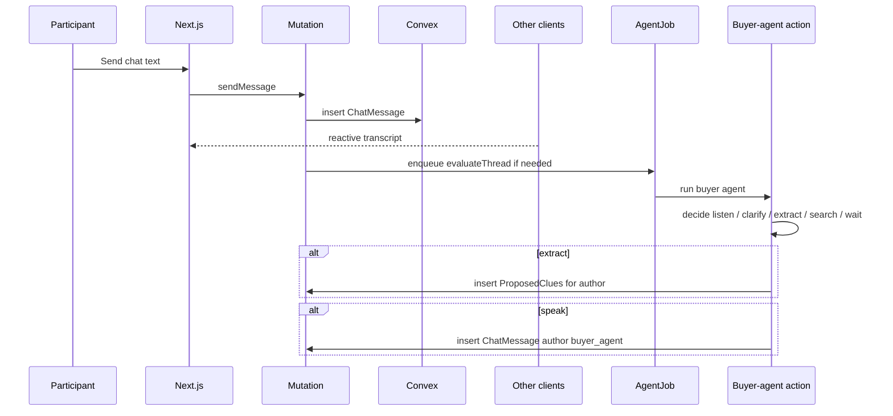

# Architecture

Smallest coherent system that supports the product in [PRODUCT.md](PRODUCT.md): a Next.js client and a Convex backend. External providers are called from Convex actions. There is no second database and no dedicated queue service. The one Python process is the Fetch.ai council coordinator in `fetch-agent/`, recorded in “Decision: Fetch.ai AI Council coordinator” below; Convex stays authoritative for everything it touches.

[PLAN.md](../PLAN.md) suggested an optional Node worker and a possible Python optimizer. Both remain rejected unless a spike proves Convex actions cannot call the chosen provider.

## Decisions

### D25 — TikTok inspiration on trend clouds (trial, 2026-10-25)

The existing public TikTok search actor (`xmolodtsov/tiktok-search-scraper`, same Apify account, $0.50 cap) was only reachable for reviewed fashion terms and had no UI. A trend cloud's "See TikToks" now runs one search for that cloud's own query, which is already a sourced, screened Google Trends suggestion, so no memory, name or free text becomes a TikTok search. One search per room and query per day, only on an explicit tap; 12 posts fetched, up to 6 public, non-advertising posts kept as links only (no captions, profiles or media). The board plays them with TikTok's own embedded player. Labelled as inspiration, never facts about the recipient or checked products. Same provider and service boundary as D13/D17.

### D25 — Scrapewise replacement shopping actor (conditional go, 2026-10-25)

Dev 4 is replacing the missing-link automation-lab source with `scrapewise/google-shopping`, pinned build `0.1.46`. Same Apify service and token; no extra service or database. Request one US/English query, at most 20 items from one page, budget filter, and a $0.40 run charge cap. Offers, direct-store resolution, details and price history are disabled. A listing links to the observed Google product page; this is not a verified retailer checkout URL. Normalize explicit USD, numeric `price` reconciled against `priceText`, `store`, `imageUrl`, and the public `productUrl`. Missing source links still drop rows; unknown prices remain unknown. Legacy parsers stay for recorded observations. One synthetic `hiking backpack` live check succeeded: run `fLbkGQez9dtwdzEUJ`, dataset `C7spheQO46lAxF1NY`, 20 normalized listings with observed prices and images, about 14 seconds end to end. The reduced recorded response is `convex/research/fixtures/scrapewise-shopping.json`. This verifies that query and the production provider/parser path, not arbitrary searches or browser checkout.

### D24 — Google Shopping actor switched to automation-lab (live no-go, 2026-10-25)

The previous `johnvc` actor returned a monthly-allowance notice. Research was switched to `automation-lab/google-shopping-scraper`, using the same Apify token with `queries`, US/English localization, `maxResults: 20`, optional budget `maxPrice`, and a $0.40 run charge cap. The cap does not guarantee a result count. No successful build is pinned.

**Live verification failed:** one synthetic `hiking backpack` search (run `ESUSgJwQdzf1qxyi2`, dataset `DfO8vaVlmz9XMtT1f`) ended `SUCCEEDED` at the provider but returned 16 rows with empty `productUrl` and `imageUrl` on every row. Zero met the listing contract. This actor is **not ready for live gift discovery** in the tested configuration. Do not turn titles into invented merchant links, approve a build based only on provider status, or automatically repeat paid runs. The recorded response is `convex/research/fixtures/automation-lab-missing-links.json`; the job now explains the missing-link failure. Previously verified fixtures remain useful for an explicitly labelled offline rehearsal, not a fresh live result. The old page parser remains for historical observations. The direct Python council fallback still references the historical actor; configured room research uses the Convex bridge. Google Trends uses a separate actor.

### D23 — Directions between memories and gifts (trial, 2026-10-24)

Trial on `dev4/directions-trial`, not yet on `refactor`. Trend sprouts per memory flooded the map with generic searches, and one search could fill the gift ring with one product type, so "Why this gift?" had nothing to say. The trial adds a middle layer: the council proposes 3–4 **directions** that each combine at least two memories (or one explicit wish), asks one question when a direction is broad, and research runs once per direction with two gifts shown from each. Trends become a few clouds people can catch into the next directions; they never search by themselves. Same stack: one new Convex table (`mapDirections`), optional fields on `researchJobs` and `mapSharpens`, two new signal kinds, the existing model adapter and Apify search. No new provider or service. Contract: "Directions flow — trial (D23)" in [CONTRACTS.md](CONTRACTS.md).

### D22 — Model screen for Google Trends ideas (2026-10-24)

Related Google searches include news, scores and lookups ("hiking deaths", "tennis results"). After a trend run succeeds, `convex/research/trendScreen.ts` sends up to 40 candidate phrases and the seed term to the **existing** configurable model adapter (Dev 3's `LLM_*` settings, `extractor` role, Zod-validated). The model only labels each phrase `product`, `style`, `experience` or `not_gift`. It cannot add or reword searches: only exact phrases from the scraped data are kept, and the deterministic news/lookup floor still applies on top. If the model is unset, fails or returns invalid JSON, the word filter is used instead; each stored sample records which (`screen: "model" | "words"`). `TREND_AI_SCREEN=off` disables the call. Cost: one model call per completed trend lookup. No new provider, SDK, table or service; Dev 3 owns the adapter and should review the prompt. When a check yields nothing, the map says why (`emptyTrendNote`) instead of staying silent.

### D20 — Room photos are shared with the room (2026-10-24)

Photos added on the gift map are visible to every room member. This changes the P0 rule that uploaded photos were owner-only and deleted after reading, for photos added on the map only. The private read is unchanged: each photo is uploaded twice, a shared copy in `roomPhotos` (`convex/photos.ts`) and a private copy that the extractor reads once and deletes. AI guesses from the photo stay private until published. Shared copies use the same upload grants, type and size checks as evidence uploads, are kept by the stale-upload sweep, cannot be claimed by the read-once pipeline, can be deleted only by their uploader, and are purged with the room. Safeguards and wording: [DATA_AND_PRIVACY.md](DATA_AND_PRIVACY.md). Decided by the team lead on request; owners: Dev 3 (map, photos), Dev 2 (media hardening, review requested).

### D19 — Map-first room (2026-10-24)

The gift map becomes the room. The app opens in a lobby in front of the present (the garden view); when the organizer starts the room, the camera zooms out and the map opens around the present, which becomes the box at its center. The tower step, the Backstage drawer, the Gifts drawer, the separate `/room/[id]/map` page, and the React Flow arrange view leave the main path. Imports, photos, research, votes, selection, and approvals all happen on the map.

- **Layout.** Rings: published clues outside, suggested themes in the middle, listings inside (placed between the themes their recommendation cites), the box at the center. Ring positions are computed on the client from room data and are presentation only. `moveNode` is no longer needed on the main path.
- **Authority unchanged.** Convex owns clues, themes, signals, listings, selection, caps, and revisions. Pulls are advisory. Only the organizer selects; only people approve.
- **Reuse.** Listing pulls map to the existing `castVote` up/down. “She has it” and “too pricey” map to `setFeedback`. Cursors reuse `moveCursor` and `listCursors`. The box uses the existing proposal, cap, and approval functions.
- **New, proposed.** Suggested themes and direction signals on clues and themes. See “Map-first room (proposed)” in [CONTRACTS.md](CONTRACTS.md). Nothing is built yet.
- **Privacy unchanged.** Imported text and photos stay owner-only. The map shows a contributor their own private items with an “only you” marker and shows everyone else only published clues. Sharing a photo image itself would be a new consent step and is an open decision in [EXECUTION_PLAN.md](EXECUTION_PLAN.md).
- **Promotion.** This promotes the map from P2 to P0 (AGENTS.md requires recording it). The fallback is listings on the inner ring by score, without themes.

Owners: Ally (lobby), Dev 1 (map UI), Dev 2 (projection and signals), Dev 3 (themes, sharpen, council wiring), Dev 4 (listings by theme). Plan and milestones: [EXECUTION_PLAN.md](EXECUTION_PLAN.md).

### D20 — Gift Twin and agent collaborators (demo, 2026-10-24; amended same day)

A recipient can pair a **Gift Twin** with a gift room from their Mac (`gift-twin/`, a Node/TypeScript CLI). With the recipient's **one-time permission**, the companion reads the most recent 1 MB of iMessage content from the local `chat.db` (read-only, macOS Full Disk Access) and uploads **only the messages the recipient sent** (text and send time; never other people's messages, handles, chat names, or attachments) to a temporary vault in Convex. A cloud twin agent acting for the recipient finds gift-feasible insights and votes up or down on the room's ideas, both existing ones and ones added while the vault is open. The vault is deleted after 24 hours, on `forget`, on disconnect, or on room purge.

- **Amendment (same day).** The first version extracted on the Mac and sent one screened report; uploading raw messages was rejected. It is now adopted, because on-device extraction could not see ideas the room adds later and needed a local model for quality. The privacy promise moves from "messages never leave the Mac" to "messages are visible to no person, are read only by the twin agent acting for the recipient, and are deleted within 24 hours". The recipient sees exactly this before agreeing, and `device.startUpload` refuses without `consent: true`.
- **Recipient page amendment (same day).** Room members create a single-use recipient link in `/room/[id]/twin`; `/twin` provides terms, explicit acceptance, local file selection with immediate upload after consent, status and deletion. SQLite WASM (`sql.js`, locally bundled, no new provider/service) reads a selected `chat.db` in browser memory using the CLI's newest-1-MiB scan and existing upload preparation; only sent text/time reaches the existing vault. No additional pre-upload content screening or review is added. Browsers cannot directly open Messages or grant themselves Full Disk Access. Raw databases never reach Next.js or Convex. The CLI remains supported. Browser tokens live in tab session storage, never the URL; invite codes use URL fragments. Browser database compatibility and real macOS file selection remain **unverified** until a live spike succeeds.
- **Authority.** Convex stays authoritative. Agent collaborators are not participants: no share, cap, selection, or approval. Twin votes are advisory posts, separate from participant `votes`, and never enter selection or allocation. **Exception to rule 4 (AI may not publish clues), recorded here:** Unwrap's server-side gift agent publishes twin notes as clues without a human tap, because the recipient authorized the source and a manual review step made the demo feel like a form. Downvotes become exclusion/ownership clues; the friend's original clue is never edited. Guardrails are deterministic: low confidence is dropped, every agent output is re-validated with Zod before insert, vote refs must match a current room idea (the server keeps its own idea text), the gift agent's model can only veto, and clues are attributed to the inviting member (who can withdraw them).
- **Privacy rule mapping.** AGENTS.md says raw imported messages are visible only to the uploader and the extraction action running as them. Here the uploader is the recipient's device, which cannot read the vault back, and the only reader is `internal.giftTwin.agent.*` (model role `recipient`). The buyer/gift agent receives screened sentences only. Recipient messages and contributor evidence stay separate flows (rule 5).
- **Transport.** The companion calls public Convex functions with a bearer device token it generates locally; only the SHA-256 is stored. The watch loop uses the Convex scheduler (no cron, no new service). No new HTTP routes or providers: the existing Chat Completions adapter reads the messages when configured; without it, deterministic patterns decide.
- **Isolation for the demo.** New files only (`convex/giftTwin/`, `lib/agentCollaborators/`, `gift-twin/`, `components/giftTwin/`, `/room/[id]/twin`), plus one-line hooks in `convex/schema.ts`, `convex/lib/roomPurge.ts`, `tsconfig.json`, and `package.json`. Gated by `GIFT_TWIN_DEMO_ENABLED=true`. P0 does not depend on it.
- **Generalization.** The same tables and feed carry the planned trend agent (`kind: "trend_scout"`).
- **Unverified.** Real `chat.db` reading has fixture and synthetic-database tests only; it needs a live check on a Mac with Full Disk Access. Model extraction quality and Apple's `attributedBody` format across macOS versions are unverified.

Rejected: making the twin a `Participant` (would enter allocations and approvals); counting twin votes in participant `votes` (agents must not steer selection); keeping messages beyond a short TTL; uploading friends' messages (third parties never consented); a native macOS app for the demo (slower to ship, same data path); a manual "Add to room" / "Ask the twin" interface (replaced by the gift agent's review); requiring repeated mentions (too strict). Details: [GIFT_TWIN.md](GIFT_TWIN.md).
### D14 — Reviewed catalog evidence for missing hobby terms (2026-10-24)

Some real tool titles omit their hobby, and the shopping Actor returns no category/description field. Dev 4 adds a small, reviewed manufacturer catalog (two initial model identities) for derived category matching at read time. Exact title/model identity is required; seller names, search queries and social popularity are insufficient. Ownership remains literal; explicit exclusions can use the verified category/manufacturer, with source-bearing explanations for derived positive matches. No state, provider, money authority or shared endpoint changes. This bounded catalog does not solve arbitrary product classification. See “Reviewed catalog matching” in CONTRACTS.md and [DEV4_CATALOG_MATCHING.md](DEV4_CATALOG_MATCHING.md).

### D13 — Public TikTok fashion discovery experiment (2026-10-24)

Dev 4 evaluated `clockworks/tiktok-scraper` build `0.0.620` as a local public fashion-context source. One public style query, at most 20 requested posts, normalized captions/hashtags/URLs/timestamps and engagement snapshots only. No recipient accounts, private messages, profile crawling, downloads, vision provider, or deployed changes. Recent sampled posts are not a platform-wide trend chart; a single engagement snapshot cannot establish growth. Existing shopping remains the only product source. Results: [DEV4_TIKTOK_SPIKE.md](DEV4_TIKTOK_SPIKE.md).

The first source timed out at device registration with zero posts: **no-go for this configuration**. The second candidate, `xmolodtsov/tiktok-search-scraper` build `0.1.39`, returned 19 posts in 11.322s with a global 20-result cap and no expansion pools or author-profile/comment add-ons. Six passed the independent 30-day date check; three creators supported one loose-fit-jeans discovery, which fed 40 shopping results. **Conditional go for local caption-based inspiration; production reliability and platform-wide trend coverage remain unverified.** Regional scope remains unknown. Provider default author metadata is not used for preference inference; normalized observations retain only the minimal documented fields.

### D12 — Local trend discovery experiment (2026-10-24)

Dev 4 evaluated `apify/google-trends-scraper` build `0.0.141` as a public category-context source. This is a standalone script, not a second product catalog or a deployed service. It sends public search terms only, retains source/time-range/geo provenance, and cannot publish clues or change recommendation scores. Existing shopping retrieval remains unchanged. Production integration requires a separate reviewed contract/job change. See [DEV4_TRENDS_SPIKE.md](DEV4_TRENDS_SPIKE.md).

The first candidate timed out with zero completed pages at 180 seconds: **no-go for this configuration**. The second candidate, `agenscrape/google-trends-scraper` build `1.0.21`, passed two live related-search runs (about 14s and 12s; no browser-based topics): **conditional go for local category discovery**, not verified production reliability. One discovered query successfully fed the existing shopping Actor. Both use Apify; neither replaces the product source. Shared additive `TrendContext` / `TrendObservation` types are consumed only by local scripts/tests; no database migration or production scoring change.

The agenscrape candidate was later promoted to a persisted room job (`convex/research/trendJobs.ts`, additive `trendJobs` table): membership-checked, one explicit human request per published interest, $0.20 cap, names/numbers refused before any paid call, and an optional `trendJobId` handoff that sets the one shopping query. Trend signals still never change scores or become per-product claims. Needs the next team deploy. Contract: "Live Google Trends discovery jobs" in [CONTRACTS.md](CONTRACTS.md).

### D18 — Unverified local-activities spike: Google Maps places (2026-10-24)

Dev 4 ran one bounded paid test of `compass/crawler-google-places` (build `0.14.775`, run `Uhqy2vo2ejbjCdNSH`) as a candidate source of real local-activity gift ideas near an organizer-typed city. This is an **UNVERIFIED local spike only**: one search term, one synthetic public city (`San Francisco, CA, USA`), 10 places, every personal/expensive add-on disabled (no reviews, reviewer data, images, contacts/leads, social enrichment, detail pages or web results). It is **not deployed, not wired into Convex**, changes no schema, contract or score, and **needs team OK before any production use**. The run returned 10 usable public pottery-class studios in ~17s for a run-reported $0.04005 (not a settled invoice; the intended $0.10 charge cap is below the platform's $0.50 minimum, so the enforceable ceiling was $0.50 with the input still bounding expected spend to ~$0.04). Key limitation: `priceLevel` was `unknown` for every place, so results can inspire experience ideas but cannot feed a contribution proposal, which requires an observed price. Results and privacy notes: [DEV4_PLACES_SPIKE.md](DEV4_PLACES_SPIKE.md).

### D11 — Photo clues as P0 evidence input (2026-10-24)

Product cards show real source photos (P0). Photo clues (P0), screenshot clues (P1-C), and voice notes (P2) are read once by the vision-capable model into private text or observation rows; the uploaded file is deleted. No face recognition — the uploader taps who the recipient is. Gift choice is visual, and non-text input is the strongest “you remembered” moment, but one clue pipeline with one human gate is easier to secure than three. Rejected: storing raw images or audio; a separate image-clue pipeline; face recognition or identity inference; AI-generated product images. Contracts: “Photo observation” in [CONTRACTS.md](CONTRACTS.md).

### D10 — Bounded research feedback and cached replanning (2026-10-24)

Member 3 and member 4 share one database/catalog projection for ranking and evidence. Each research request captures its requester/message context and at most one persisted continuation pointer. Completion/failure/timeout and continuation scheduling are one transaction. The follow-up is a distinct, version-fenced job; it cannot start research or call another recipient agent. Confirmed knowledge changes can re-evaluate the existing pool after a short debounce, but cannot authorize another paid provider run. Purchase facts in recommendation messages are rendered by application code from current observations, not model prose. Question replies require an explicit slot. No new service/provider is added.

### D9 — Agent backbone implementation (2026-10-24)

Dev 3 implements bounded role handoffs within Convex, using one configurable Chat Completions-compatible model adapter (`LLM_BASE_URL`, `LLM_API_KEY`, `LLM_MODEL`). JSON mode plus strict local Zod validation is used; provider/model support remains **unverified** until a credentialed spike succeeds. No SDK, additional database, or agent service is added. Reference: [JSON mode and structured outputs](https://developers.openai.com/api/docs/guides/structured-outputs?api-mode=chat).

Scheduling and effect commits happen in mutations. An action must claim a pending job; all commits fence on status, attempt, membership, and current input. A watchdog marks abandoned work uncertain. Model retries are bounded; HTTP failures do not expose response bodies or secrets. UI activity is a separate projection of fixed event summaries. Recipient-agent support remains optional, with a server-gated synthetic operator profile, grants, revision-aware revocation, and fixed output guidance. Existing P0 does not depend on it.

| ID | Decision | Rationale | Rejected alternative |
| --- | --- | --- | --- |
| D1 | Unwrap is a collaborative evidence-backed studio. AI improves decisions; it is not decoration. | Matches the pitch and GiftSync chat requirement. | Chat wrapper around a generic recommender. |
| D2 | Differentiation is shared evidence, cited recommendations, revision-aware group decisions, and (later) permissioned recipient knowledge. | Honest vs existing AI gifters. | “World’s first AI gifting app.” |
| D3 | Contributor evidence and recipient-authorized data are separate stores with separate policies. | Required by the two consent flows. | One “user context” blob; prompt-only isolation. |
| D4 | P0 is pledges + approvals. Payments are P1-B. LLMs cannot move money. | Payments are the highest-risk workstream. | Sandbox capture as a P0 dependency. |
| D5 | AI interprets; deterministic code authorizes, allocates, and transitions state. | Money and membership must be testable. | Letting the model emit “approved” or “charge this.” |
| D6 | Price and availability require a source URL and `retrievedAt`. | Judges and buyers must be able to check. | Model-invented products or stale remembered prices. |
| D7 | Contracts first; every workstream mocks the others. | Four people, 36 hours. | Implementing against implicit types. |
| D8 | A working demo beats feature count and sponsor count. | Hackathon scoring happens on what runs. | Building every track integration. |
| D9 | P1-B payment state (BE-015) lives in Convex documents behind `PAYMENTS_SANDBOX_ENABLED=true`. Pre-capture revisions stay editable and unwind their authorizations when superseded; from `capturing` until `test_funded` or completed recovery, edits are refused rather than queued as drafts. | Keeps P0 unchanged when the flag is off, and avoids a second pending-edit model during the riskiest window. | Freezing at first authorization (blocks normal edits); queuing draft edits during capture (more state, no demo value). |
### Stack evaluation

| Choice | Verdict |
| --- | --- |
| Next.js + React + TS + Tailwind | Confirmed starting point. One app for solo and group. |
| Convex | Confirmed. Authoritative room state, reactive queries, membership. |
| One tool-capable LLM + Zod | Confirmed. Provider and model ID are **unverified** until Phase 0. |
| Apify as first product source | **Conditional go for discovery.** RC-002: `johnvc/google-shopping-api-google-shopping-products-prices-deals`, build `0.0.142`, passed two live searches (40 products each). Links are Google Shopping URLs; direct merchant navigation and final prices remain unverified. Results and limitations: [DEV4_SOURCE_SPIKE.md](DEV4_SOURCE_SPIKE.md). |
| React Flow | Proposed for the map. P0 may ship a simpler graph or list if it threatens the critical path. |
| Motion / CSS | Confirmed for lightweight, state-honest animation. |
| Stripe test mode, manual capture | P1 only. **Unverified** against current sponsor rules. Visa eligibility is not implied by Stripe. |
| Vercel + Convex | Confirmed hosting. No extra worker host in P0. |
| Bitdeer / Factory / Bright Data | Conditional sponsor options. Adopt only after a spike shows a real product role. |
| Convex file storage | P0 (photo clues), P1-C, P2. Holds photos, screenshots, and voice notes until they are read, then deletes them. |
| Vision input on the chosen LLM | P0 (photo clues) and P1-C. **Unverified until the Phase 0 spike.** Must work on the same provider; no second LLM SDK. If it fails, photo clues demote to the text-only spine. |
| Speech-to-text API | P2. **Unverified** new provider. Spike before any code depends on it. |

## Component diagram

Four independently implementable surfaces:

| Surface | Owner | Talks to the others through |
| --- | --- | --- |
| Room UI | Dev 1 | Convex queries/mutations in [CONTRACTS.md](CONTRACTS.md) |
| Schema, membership, proposals | Dev 2 | Document shapes and mutation names |
| Agent actions and tools | Dev 3 | `AgentDecision`, clue payloads, recipient-query API |
| Research + commerce adapter | Dev 4 | `ProductListing`, `ResearchJob`, later `PaymentAttempt` |

## Client / server boundary

The browser never calls the LLM, Apify, or Stripe directly.

- **Queries** return membership-filtered projections. Private imports, unpublished clues, and contribution caps are stripped for non-owners.
- **Mutations** are the only way to change room state. They validate identity, revision, and money.
- **Actions** perform external I/O. They must not be the source of truth; they write back through mutations.

Next.js server components may render public marketing or the reveal page. They still read Convex; they do not keep a parallel store.

## Convex architecture

Use one Convex deployment.

| Mechanism | Use |
| --- | --- |
| Tables + indexes | Rooms, members, messages, clues, listings, jobs, revisions |
| Queries | Chat transcript, published knowledge, shortlist, proposal view |
| Mutations | Send message, publish clue, set cap, select gift, approve |
| Actions | Extract clues, decide whether the agent should speak, search products, query recipient agent, Stripe calls |
| HTTP routes | Stripe webhooks in P1-B only |
| Scheduled functions | Job timeouts and stale-listing refresh, kept minimal |

Authoritative application state lives in Convex documents. Authoritative payment state lives at Stripe. After every provider call, reconcile into our documents. A successful Convex write does not mean Stripe captured, and a browser redirect does not mean payment succeeded.

## Data model

Core entities and owners:

| Entity | Owner | Notes |
| --- | --- | --- |
| `Room` | Dev 2 | Occasion, deadline, `USD`, budget hint, current revision pointer |
| `Participant` | Dev 2 | Identity, role `organizer` \| `contributor` |
| `ChatMessage` | Dev 2 | Human or `buyer_agent` author |
| `EvidenceSource` / `PrivateMessage` | Dev 2 | Contributor-private |
| `ProposedClue` | Dev 2 store / Dev 3 producer | Contributor-private until publish |
| `PublishedClue` | Dev 2 | Room-visible knowledge |
| `RecipientPreference` | Dev 3 | P1-A only; separate consent |
| `ResearchJob` / `ProductListing` / `Recommendation` | Dev 4 | Provenance required |
| `GiftSelection` | Dev 2 | One current selection per room |
| `ContributionLimit` | Dev 2 | Private cap |
| `ProposalRevision` / `AllocationShare` / `Approval` | Dev 2 | Deterministic |
| `PaymentAttempt` / `ProviderEvent` | Dev 2 records / Dev 4 adapter | P1-B |
| `AgentJob` / `AgentDecision` | Dev 3 | Includes listen/wait with no chat reply |

Full field lists: [CONTRACTS.md](CONTRACTS.md).

## Realtime message flow

Deduplicate agent jobs per room with an `inputHash` of `(roomId, lastMessageId, knowledgeRevision)`. A newer message supersedes an in-flight evaluate job; the old job writes `stale` and does not post.

## AI orchestration flow

1. Mutation persists the human event.
2. Mutation inserts `AgentJob` `pending` with the input hash.
3. Action loads **only** the tool-permitted snapshot for the buyer agent.
4. Model returns a structured `AgentDecision`. Zod validates it.
5. Deterministic code executes allowed effects: propose clues, request research, post one chat message, or no-op.
6. Effects that fail authorization are dropped and logged. The model does not retry itself in a loop; the action schedules at most one follow-up if `needsFollowup` is set and a budget remains.

Recipient-agent calls (P1-A) go through the disclosure policy, not through a shared “memory” tool. See [AI_AGENTS.md](AI_AGENTS.md).

## Research and recommendation flow

1. A participant or the buyer agent calls `startResearch`.
2. Mutation writes `ResearchJob` `pending` with the clue IDs, budget, and knowledge revision.
3. Dev 4 action calls the one approved source.
4. Results are normalized to `ProductListing`. Rows without `sourceUrl` + `retrievedAt` are discarded.
5. Scoring reads published clues and listing facts. Trend score is optional and defaults to zero.
6. `Recommendation` rows store ranked candidates plus explanation IDs.
7. If the room’s knowledge revision is newer than the job’s input, the job becomes `stale` and does not overwrite the current shortlist automatically.

## Shared gift state

Each room has at most one `GiftSelection` in `active`. Votes and reactions are advisory. The organizer (or a unanimous rule we can implement quickly) sets the selection.

Changing the selection, the observed payable total, or any allocation input mints a new `ProposalRevision` and sets prior approvals to `invalidated`.

## Proposal revision handling

A revision is immutable. It contains:

- `selectionId`, listing snapshot, quantity
- `payableTotalMinor` and which amount parts are known
- `shares[]` for every participant
- `conditions[]`
- `expiresAt` (optional)

Allowed transitions are in [COMMERCE_AND_PAYMENTS.md](COMMERCE_AND_PAYMENTS.md). Clients cannot patch a frozen revision.

## Authentication and authorization

Decision (Phase 0): Convex Auth (`@convex-dev/auth`) with the anonymous provider. Each browser signs in anonymously; membership is the `Participant` row for that user. A room invite token grants `Participant` membership. The Convex deployment needs `JWT_PRIVATE_KEY`, `JWKS`, and `SITE_URL` (run `npx @convex-dev/auth` once per deployment).

P0 permission choice: any member can start research; only the organizer confirms the selected gift.

Authorization checklist, enforced in mutations/queries:

| Action | Who |
| --- | --- |
| Read chat, published clues, listings, current proposal | Room members |
| Read/write own import, proposed clues, cap | Owning participant |
| Publish a clue | Owning contributor of that proposed clue |
| Start research, select gift | Organizer, or any member if we keep P0 loose — pick one in schema and stick to it. Default: any member can start research; organizer confirms selection |
| Approve revision | Each participant for their own share |
| Read recipient preferences | Recipient-agent tools after policy grant |
| Payment mutations | P1-B, server only |

A room link never authorizes private imports, unpublished clues, contribution caps, or recipient-agent storage.

## Background jobs

Represented as documents, not a separate queue:

- `AgentJob`
- `ResearchJob`
- `PaymentAttempt` (P1)

Each has `status`, `attempt`, `idempotencyKey`, `inputHash`, and `lastError`. Actions are idempotent on `idempotencyKey`. Cap automatic retries at two. Terminal states: `succeeded`, `failed`, `stale`, `canceled`.

## Idempotency and concurrency

- Client mutations that create revisions, jobs, or payment attempts require an idempotency key.
- Optimistic concurrency: mutations that depend on `currentRevisionId` fail with `invalid_revision` if the pointer moved.
- Two clients cannot approve different revisions into one purchase: approval writes check `room.currentRevisionId === approval.revisionId`.
- Capture (P1) flips the current revision to `capturing` before any Stripe call. Edits are refused with `invalid_revision` until the revision is `test_funded` or recovery ends in `canceled` (see D9).

## Error handling and recovery

| Failure | Application behavior |
| --- | --- |
| LLM validation failure | Job `failed`; no clues written; UI shows “couldn’t read that yet” |
| Product source timeout | Job `uncertain` then `failed`; keep last good shortlist |
| Stale research | Mark `stale`; do not clobber a newer selection |
| Infeasible allocation | Proposal `infeasible`; no approval collection |
| Provider payment timeout (P1) | Attempt `uncertain`; reconcile from Stripe; UI shows recovery |
| Partial capture (P1) | Stop remaining captures, cancel uncaptured auths, refund if needed, `recovery_pending` |

The UI owns truthful empty, error, and recovery states. See [COMMERCE_AND_PAYMENTS.md](COMMERCE_AND_PAYMENTS.md) for payment recovery invariants taken from [PLAN.md](../PLAN.md).

## Deployment boundaries

| Host | Runs |
| --- | --- |
| Vercel | Next.js UI |
| Convex | DB, reactive sync, actions, (P1) webhook |
| LLM provider | Inference only |
| Apify / shopping API | Retrieval only |
| Stripe | Payment objects (P1) |

No Kubernetes, no extra Redis, no separate auth vendor required for the hackathon.

## Failure recovery (system)

- If Convex is down, the demo is down. There is no offline mode.
- If the LLM is down, chat and manual clue entry still work. Ship a manual “add clue” form as a fallback.
- If the product API is down, show the last retrieved listings with timestamps, labeled as cached, or a fixture set that is **never** presented as live.
- If Stripe is down or the spike fails, P0 pledges remain the product.

## Authority map

| Fact | Authority |
| --- | --- |
| Who is in the room | Convex `Participant` |
| What was said in-room | Convex `ChatMessage` |
| What the group has confirmed | Convex `PublishedClue` |
| What a contributor has not published | Convex `ProposedClue` / `PrivateMessage` |
| What the recipient agent may know | Convex `RecipientPreference` + policy |
| What a product costs right now | External listing at `retrievedAt`; our row is an observation |
| Whether a revision is approved | Convex `Approval` rows |
| Whether money moved | Stripe (P1); otherwise nothing moved |

## Implementation seams for four developers

Dev 1 can build the entire atelier against mock Convex hooks that satisfy the query shapes.

Dev 2 can ship schema, membership, chat, publish, allocation, and revisions with fixture clues and listings.

Dev 3 can run extraction and agent decisions in actions that write the documented payloads, even if the UI is still ugly.

Dev 4 can normalize one live search into `ProductListing` and score against fixture published clues.

Integration checkpoints are in [EXECUTION_PLAN.md](EXECUTION_PLAN.md).

## Dev 4 research integration (RC-004 / RC-006)

The research mutation uses Dev 2's membership and job-insertion helpers. Pure brief/ranking functions are provided by the parallel Dev 4 workstream. Provider start/poll/dataset calls run in Convex actions with APIFY_TOKEN from deployment environment variables. Durable scheduled polls retain provider run IDs; a watchdog marks stranded workers uncertain.

A completion transaction validates current knowledge and request order before writing listings. The recommendations query re-ranks the latest successful candidate pool against current room clues. No extra services or queues are introduced. The existing brief validator remains unchanged: research explicitly stores the brief without duplicated roomId and restores it at the provider boundary.

Local tests mock paid provider traffic. This checkout still needs the team's Convex deployment configuration and its APIFY_TOKEN before a deployed end-to-end test. Do not create a competing team deployment just for Dev 4. Anonymous-auth setup belongs to Dev 2 / frontend integration.

## Decision: Fetch.ai AI Council coordinator (additive)

**Status:** local agent verified (Chat Protocol manifest published, Almanac API registration, full council run over HTTP). Agentverse mailbox + ASI:One chat are **unverified** until run with the team's Agentverse account.

One Python uAgent in `fetch-agent/` (`uagents==0.25.5`, AgentChatProtocol 0.3.0) is the only Fetch.ai registration. It runs five roles — Archivist, Muse, Scout, Keeper, Courier — as real functions and replies in ASI:One without needing the website. It is a new external API (Agentverse / ASI:One), not a second app: Convex stays authoritative for state, and the Scout's product research reuses the existing Apify pipeline through a secret-gated Convex HTTP action rather than a new provider.

Flow: ASI:One or `/council` page → coordinator → `POST /council/events` (Bearer `COUNCIL_INGEST_SECRET`) → Convex `councilEvents` / `giftDecorations` → `council.demoState` subscription → avatars animate locally. Products and raw memories never travel in events. The language model (ASI:One `asi1`) may only add clues; products, prices and links come only from research. Rejected: five separately registered agents (no new capability, five times the setup); runtime 3D generation for charms (slow, unbounded; a fixed library is rendered locally instead).

### D15 — Recorded fashion evidence in the existing buyer snapshot (2026-10-24)

The first Dev 4/Dev 3 discovery bridge reuses Alan's buyer snapshot and search decision,
under the existing demo flag only. A confirmed vintage-denim interest can receive the
recorded source-backed directions from the verified spike, with original dates and a
24-hour expiry. It creates no service, paid call, schema migration or preference. The
existing shopping worker still receives one chosen query and owns product facts. This
validates the handoff without turning the standalone TikTok spike into an automatic paid
pipeline. Live refresh and displayed social provenance remain pending.

### D16 — Begin isolated Stripe sandbox adapter work (2026-10-24)

Alex requested advancing P1 alongside final P0 acceptance. Dev 4 starts server-only
Stripe REST transport and raw-body webhook verification against mocks. Stripe hosted Checkout create/retrieve/expire is **verified in sandbox** by
the October 24 Dev 4 spike. Card authorization, capture, actual webhook delivery
and application-state integration remain **unverified**. No extra SDK, database, public endpoint, capture scheduler or payment UI
is enabled. P0 stays usable without Stripe; the current product still ends at
pledges. Dev 2 retains payment state, current-revision approval checks, freeze rules
and durable event idempotency. API requests pin `2025-06-30.basil` for reproducibility.
Official API references: https://docs.stripe.com/api/checkout/sessions/create,
https://docs.stripe.com/api/checkout/sessions/expire,
https://docs.stripe.com/api/payment_intents/capture,
https://docs.stripe.com/api/refunds/create and https://docs.stripe.com/webhooks.

### D17 — Explicit persisted public-style discovery (2026-10-24)

Dev 4 adds a research-owned `fashionJobs` table through `research/fashionSchema.ts`;
`schema.ts` only includes that additive fragment. Existing rows and money/agent
state are unchanged. Membership-checked mutations explicitly start one pinned
GoFetch TikTok search (`xmolodtsov~tiktok-search-scraper`, build `0.1.39`, max20
posts, cap $0.50). Pending is stored before any external call; uncertain starts
are not retried. Known runs can resume GET polling. Current confirmed denim clues
produce a fixed public seed; private imports and arbitrary queries are excluded.
Only sanitized derived style directions, source links and original provenance are
persisted. A 24-hour cache and current-knowledge fence apply at reads and shopping.
`startResearch` accepts an optional discovery job reference; old callers are unchanged.
UI cards and Alan's optional tool use remain consumer integration work.

The Actor/input combination had one successful standalone spike. The persisted
pipeline also completed one personal-dev run on cool-bat-724: 20 returned posts,
8 valid recent posts, zero corroborated garment directions. Provider start/poll,
completion and the member query were verified live; no live discovery-to-shopping
direction was established by that empty sample. Empty samples preserve the
ordinary published-clue search. Fixture tests do not establish production provider
reliability or platform-wide trends. No new product
source, AI provider or database is added. The fixed Stripe adapter additionally
supports canceling a zero-capture manual hold, per current official API docs;
actual hosted-Checkout hold cancellation remains **unverified live**.

### D20 — Explicit contribution simulation for the demo (2026-10-24)

Alex chose a small simulated payment ending rather than further live refunds,
partial captures or recovery work. Convex stores revision-bound simulation marks
in a separate `paymentSimulations` table. Current membership, exact own shares
and full proposal approvals are checked deterministically. Only the organizer
can mark the demo wrapped after every simulated contribution. A revision or
approval change invalidates displayed progress. Neither simulation nor animation
changes Stripe attempts, real funding, proposal approvals or merchant orders.
The UI displays “Payment simulation” and “No money charged or gift purchased.”
No external service or secret is added. Existing sandbox primitives remain dormant.
The reusable box component is integrated by Dev 1 into the new map, with a
separate labelled local fixture preview for browser review. Actual shared runtime
acceptance remains pending deployment of the additive schema/functions.

### D21 — Evaluate Bitdeer as a replacement model provider (unverified)

Alex requested testing Model Studio with GLM-5.3-Flash. Dev 4 adds only the
standalone `scripts/bitdeer-check.mts` candidate-provider spike (documented in
DEV4_BITDEER_SPIKE.md). It targets the official HTTPS inference endpoint, uses
synthetic text and generated test images, and requires an explicit `--run` plus
privately configured key for at most three paid calls with no retries. The
existing app provider/adapter, deployment and environment files are unchanged.
Bitdeer is an **unverified alternative**, not an added active LLM service. Dev 3
must verify API parameters, application schemas, photo behavior and timing before
switching the existing configurable provider. No new SDK, database or service is
introduced. Offline fixture checks do not establish live model capability or
prize eligibility.

### D26 — Gift Twin local Moss memory (2026-10-25; local and Convex retrieval spikes verified)

Use pinned `@moss-js/moss` in a Convex Node internal action to retrieve private
recipient evidence for Gift Twin votes. Convex remains authoritative; Moss is an
ephemeral derived index, rebuilt per evaluation and explicitly closed. Only local
session add/query operations are used: never cloud create/add/push or disk save.
Moss credentials stay server-side. The SDK authenticates/downloads its model and
sends usage telemetry (opaque random session name, counts, timing, device ID);
document/query text and metadata are not sent to Moss. The existing model provider
still receives retrieved evidence in role `recipient`. The room and buyer agent
receive only screened posts through the existing review path. No voice service,
additional model, database or standalone service is introduced.

The native SDK is externalized for Convex Node packaging. Flag-off and failures
retain keyword recall. Each call checks upload identity and expiry through Convex;
no private session is reused between uploads or rooms. Numeric server diagnostics
separate setup/indexing from retrieval; cold indexing is not a sub-10ms operation.
The authenticated local macOS spike passed paraphrase, ownership and dislike
top-hit checks over eight synthetic messages (SDK 1.21.0): retrieval 1.3–2.0 ms,
indexing 12.5 ms, cold setup/model loading 23.3 seconds. This establishes only the
small local spike. Native deployment and the synthetic paraphrase probe also
passed on dev `shiny-dotterel-658`: setup 2.25 s, indexing 27.1 ms, retrieval
4.1 ms over three synthetic messages. `GIFT_TWIN_MOSS_ENABLED=true` is enabled
there. Convex replaces JS `process.env` during invocation, so native `getenv`
cannot see JS assignments. A temporary nonsecret config loaded with Node's
`loadEnvFile` sets `MOSS_MODEL_CACHE_DIR=/tmp/unwrap-moss-models` in the native
environment; the file is immediately removed. Only public model artifacts and
device identity are cached; private session documents are never persisted.
The full live room-to-model path, production deployment, larger vault performance,
and cold-start variability remain **unverified**. Automated integration tests cover
the room path using a mocked SDK; they do not establish live model answer quality.

### D27 — Responsive twin evaluations (2026-10-25)

Remove model calls from the first useful Gift Twin response. Server-pattern
insights and explicit votes are stored and deterministically reviewed first;
only unresolved votes need Moss/model processing. Model-only enrichment and
votes settle independently and retain upload/expiry checks. The fast review
receives exact inserted post IDs so concurrent unreviewed model posts cannot
bypass their existing review. No AI permission, money, consent or data authority
boundary changes.

Room knowledge changes, new map sprouts and completed product listings schedule
a transactional unchecked-idea claim after 200 ms. Duplicate wakeups do not create
duplicate votes or polling loops. The existing 30-second watch is recovery only.
Vault chunk reads run four at a time. Moss embeds a maximum of 256 distinct
messages per evaluation, preferring gift/preference language and balancing old
and recent evidence. Full-vault keyword checks remain; semantic-only recall
outside the bounded working set is a documented tradeoff. No cross-action private
cache, disk index, provider or table is added. Local synthetic indexing benchmark:
2,048 messages, 2,196 ms before vs 309 ms after, with the historical pottery
memory still ranked first. Live model and product-provider latency are separate.
Deployed to dev `shiny-dotterel-658`; a live three-message synthetic room check
passed with a published first finding at 518 ms and reviewed evaluation of a new
message at 790 ms (client/network included). The temporary room was deleted.
These timings cover deterministic evidence, not model-only or shopping latency.

## Bounded multi-gift box — Alex-authorized integration

Alex requested both single and multiple gifts in the buying flow. Keep one
Convex selection and one versioned proposal per room; add optional item snapshots
rather than a second cart/payment engine. One to twelve distinct products, one
unit each; no optimization, merchant checkout, currency conversion or inferred
shipping bundling. Allocation and approval operate on the combined estimate.
Legacy single-gift fields remain first-item compatibility projections. Simulation
continues to use the approved revision, never a client-calculated amount.
Dev 2 reviews selection/schema changes; Dev 1 consumes item arrays. Existing
rows remain valid without a data migration. No deployment accompanies this change.

## Group polling and a multi-gift map box

Alex requested live group answers rather than first-answer closure. Store
optional attributed ballots on the existing room question; no extra service or
database. Poll votes are advisory and never publish a recipient fact. Explicit
product votes take precedence, question support then steers eligible candidates
before pool limits, and existing relevance/citations remain unchanged. Source
filters remain authoritative. Selected products are kept in the room projection
across subsequent searches. The map calls atomic add/remove operations, retains
all selected product links, approves one combined versioned estimate and reveals
every item through a selectable set. Old single-gift APIs and rows remain valid.
No payment/deployment change is part of this implementation.
