# Execution Plan

Phase 1 (the hackathon spine) is done and merged to `main` and `refactor`: rooms, membership, private evidence and clue review, photo clues, live research, the agent backbone, the Fetch.ai council, votes, private caps, allocation, and revision-aware approvals. The original hour-by-hour plan is in git history.

This document is the plan for **Phase 2: the map-first room**. Product rules live in [PRODUCT.md](PRODUCT.md). The decision is recorded as D19 in [ARCHITECTURE.md](ARCHITECTURE.md). The visual reference is the guided prototype in [work/vision-lab/](../work/vision-lab/README.md) and the Gift Rings walkthrough.

## The new room flow

```mermaid
flowchart LR
  lobby[Lobby at the present] -->|room is ready| zoom[Camera zooms out]
  zoom --> map[Gift map]
  map --> share[Drop memories, photos, ideas]
  share --> themes[Council groups them into themes]
  themes --> gifts[Real gifts grow between themes]
  gifts --> steer[Pull in, push out, she has it]
  steer --> sharpen[Sharpen: one question, refined ideas]
  sharpen --> box[One gift in the box]
  box --> approve[Shares and approvals on that revision]
```

1. **Lobby.** The app opens in front of the present, in the garden view. People create or join the room here and see who has arrived.
2. **Zoom out.** When the organizer starts (or the room is ready), the camera pulls back from the present and the gift map opens around it. The present becomes the box at the center of the map.
3. **The gift map is the room.** Everything about gifting happens here: what friends share, the themes the council finds, the real products, the votes, the box, and the approvals. There is no tower step, no separate `/map` page, and no Backstage drawer on the main path.

## The map: rings

The map uses the ring layout from the Gift Rings walkthrough.

| Ring | Holds | Who adds it |
| --- | --- | --- |
| Outer | Memories, messages, photos, ideas | Anyone, by clicking empty sky |
| Middle | Themes such as "Makes things with her hands" | The council suggests; people can rename, merge, or dismiss |
| Inner | Gift ideas and real listings, placed between the themes they satisfy | Research and the council |
| Center | The box: the selected gift, shares, and approvals | The organizer selects; everyone approves |

- **Distance from the center** shows how close an item is to being the answer. **Position around the circle** shows what it is about.
- **Dragging toward the box supports; dragging away passes.** Layout is computed from room data. People do not tidy the map by hand.
- **Inputs tuck into stacks** under their theme once grouped, so the outer ring stays readable.
- **Clicking a node** opens a small row of actions under it (votes, she has it, too pricey, find gifts, edit). There are no popup panels.
- **"Why this?"** lights the path from the chosen gift back through its themes to the memories behind it.

## What moves where

| Before | After |
| --- | --- |
| Room opens in the tower | Room opens in the lobby, in front of the present |
| Tower memory game, jars, council table | Outer ring of the map; click empty sky to add |
| Backstage drawer: paste a conversation, photos, agent tools, sharing | Removed. Paste and photo are options in the map's add menu and stay private until published. Invite lives in the lobby and the header. Agent activity shows on the nodes it touches. |
| Gifts drawer, shortlist, "How the clues connect" | The inner ring of the map |
| Garden decoration and gift choice | The lobby is the garden. The final box sits at the map's center. |
| `/room/[id]/map` page with sky tree and React Flow arrange view | The map is the room view. The arrange view is retired. |
| Phone controller | The same rings as a list, with buttons for pull, pass, and add |

## What stays the same

These rules carry over unchanged and are not up for renegotiation in Phase 2:

- Convex is authoritative. Ring positions are presentation, computed from room data.
- Imported text and photos stay private to their contributor. Only published clues reach the shared map.
- Themes and AI ideas are suggestions. They never become confirmed knowledge without a person acting on them.
- Listings carry a source URL, observed price, and retrieval time, or they do not appear.
- Votes and pulls are advisory. Only the organizer selects the gift; only people approve a revision.
- Changing the gift, total, or shares mints a new revision and clears approvals.
- Private caps are visible only to their owner and the allocation code.

## Milestones

Each milestone is demoable on its own. Do them in order; M2 and M3 can overlap once the map shell exists.

### M1 — Lobby at the present

**Owner:** Ally (in progress). **Builds on:** landing page, create/join, invite links.

- The app opens in front of the present. Create and join happen here.
- The roster updates live as people join; the invite link and QR stay visible.
- The organizer starts the room. A solo organizer can start alone.
- Starting plays one zoom-out from the present to the map. Reduced motion swaps instantly.

**Done when:** two browsers join from the lobby and both land on the map, with the present now the box.

### M2 — Map shell on live data

**Owners:** Dev 1 (map UI), Dev 2 (projection and signals).

- The map renders the rings from `getMapState`: published clues on the outer ring, the box in the center.
- Clicking empty sky opens the add menu: message, photo, idea, paste a conversation.
  - A message or idea becomes a manual published clue after the contributor confirms it.
  - Paste and photo go through the existing private import and review flow. The contributor sees their private items on the map with an "only you" marker; nobody else does.
- Named cursors for everyone in the room, using the existing cursor functions.
- Node actions bloom under the selected node. No drawers.

**Done when:** two people add memories on the map and see each other's published memories and cursors live, and a pasted conversation stays visible only to its owner.

**Status (2026-10-24):** a first version runs in the live room. “Open the gift map” glides from the garden to a `map` stage in the shared world canvas (`components/world/room/GiftRings.tsx`, layout in `lib/map/rings.ts`). It shows published clues on the outer ring, the jar groups (Loves, Wishes, Moments) as interim themes, and recommended listings placed between the themes they cite. Clicking empty sky adds a memory or wish. Dragging a gift toward or away from the present casts or clears a vote, and dropping it on the present selects it (organizer) or votes for it. Not done yet: cursors on the map, private items with an “only you” marker, and votes on memories and themes.

### M3 — Themes and gifts on the map

**Owners:** Dev 3 (theme grouping, council wiring), Dev 4 (listings placed by theme).

- The council groups published clues into 3–5 suggested themes. Each theme lists the clue IDs it covers.
- People can rename, merge, or dismiss a theme. Dismissing never deletes the clues.
- "Find gifts" on a theme, or on the whole map, starts the existing research pipeline. Council progress shows on the theme being worked on.
- Listings appear on the inner ring, placed between the themes their recommendation cites. A listing that cites two themes sits closer to the center.

**Done when:** the demo memories produce themes, research returns sourced listings, and each listing's position matches the themes it cites.

### M4 — Steering and sharpening

**Owners:** Dev 1 (gestures), Dev 2 (signals), Dev 3 (sharpen round).

- Dragging a listing toward or away from the box casts the existing `castVote` up or down.
- Dragging a clue or theme records a new direction signal (see the proposed contract in [CONTRACTS.md](CONTRACTS.md)).
- "She has it" calls `setFeedback` (owned) and publishes an attributed ownership clue. "Too pricey" records a personal reaction and never changes a budget or cap.
- Every vote pulses the node for everyone, with the voter's name.
- **Sharpen** runs one bounded council round: fade what nobody pulled in, ask at most one question through the existing open-question slots, and propose up to three more specific directions. New directions need research before they become listings.

**Done when:** two people's pulls visibly reorder the inner ring on both screens, and one sharpen round asks a question whose answer moves the finalists.

### M5 — The box and approvals

**Owners:** Dev 1 (box UI), Dev 2 (unchanged proposal code).

- The organizer drags a listing into the box, or uses the select action on its node.
- The box shows the gift, the budget bar, each person's share, and approval state for the current revision, using `ProposalPanel` logic.
- Caps are set from the box. Changing the gift or a cap resets approvals in place.
- "Why this?" lights the path from the selected gift to its themes and clues.

**Done when:** the nine acceptance checks in [PRODUCT.md](PRODUCT.md) pass on the map, without opening any drawer.

### M6 — Retire the old path and rehearse

**Owners:** everyone.

- Remove the tower, Backstage drawer, Gifts drawer, and arrange view from the main path. Keep the code until the demo passes twice, then delete it in one PR.
- The phone controller shows the same rings as a list.
- Run the demo script twice from a cold start. Record a backup run.
- Update README status and this plan with what is live, mocked, and cut.

## Integration checkpoints

| Checkpoint | Must see |
| --- | --- |
| C1 | Lobby → zoom → map works in two browsers (M1) |
| C2 | Live memories, private paste, cursors on the map (M2) |
| C3 | Themes and sourced listings placed between themes (M3) |
| C4 | Pulls reorder the map for both people; one sharpen round (M4) |
| C5 | Full acceptance list on the map; old path removed from navigation (M5, M6) |

If C3 slips, ship M5 with listings on the inner ring sorted by score and no themes. The box and approvals must not wait on themes.

## Three-minute demo

| Time | Beat |
| --- | --- |
| 0:00–0:20 | Open in front of the present. "Friends remember different things." Create Maya's room; a second teammate joins from the lobby. |
| 0:20–0:35 | Start the room. The camera pulls back and the map opens around the present. |
| 0:35–1:05 | Both people click the sky and drop memories. One pastes a short synthetic chat, which stays marked "only you" until they publish two clues. |
| 1:05–1:35 | The council groups memories into themes. Find gifts. Sourced listings grow between the themes they fit. |
| 1:35–2:05 | One person pulls the mug in; the other passes on the blanket. "She has it" rests the starter kit. Sharpen asks one question; the answer moves the finalists. |
| 2:05–2:40 | The organizer drags the winner into the box. Set two caps; shares appear. Both approve. Change a cap; approvals reset; approve again. |
| 2:40–3:00 | "Why this?" lights the path back to the memories. Say what was not charged. |

### Backup

- Agents slow or down: publish clues manually, skip themes, and show listings on the inner ring by score.
- Research down: use a labeled cached listing with its retrieval time.
- Sync flaky: two browsers already in the room; narrate from the recording.

## Risks

| Risk | Fallback |
| --- | --- |
| Ring layout overlaps with real data volumes | Cap visible nodes per ring (about 8), collapse the rest into stacks |
| Theme grouping is slow or inconsistent | Listings sorted by score without themes; themes as a later layer |
| Drag-to-vote is unclear to new users | The same actions as buttons on every node |
| 3D scene performance on laptops | Lazy-load the scene; fall back to the 2D ring view |
| Removing the old path breaks the phone flow | Keep the old phone screens until the list view of the rings passes |
| Lobby and map stage clocks disagree | One stage clock owns lobby → map, the way `roomStage.ts` owns tower ↔ garden today |

## Open decisions

The team should settle these before M2 starts:

1. ~~**Shared photos.**~~ Decided (D20): photos added on the map are shared with the whole room; AI guesses from them stay private until published. See [DATA_AND_PRIVACY.md](DATA_AND_PRIVACY.md).
2. **Theme confirmation.** Do themes appear as soon as the council suggests them, or after one tap to accept?
3. **The council characters.** Do the five robots appear on the map next to the node they are working on, or only in the lobby?
4. **Chat.** The plan has no separate chat panel: messages are nodes and the council speaks in one notes line. Confirm, or keep a collapsible chat.
5. **Deployments.** `.env.local` points at development `compassionate-alpaca-531`. Docs also name `cool-bat-724` and `striped-alpaca-645`. Pick one development and one demo deployment and update the docs.

## Where to stop

Protect the path: lobby → map → published memories → sourced listings → one gift in the box → revision-aware approvals.

Cut in this order: sharpen variants, council characters on the map, theme rename and merge, the zoom animation (swap instantly instead), photo nodes, themes.

Never cut: the publish boundary, sourced listings, private caps, integer allocation, revision invalidation, honest payment copy.
