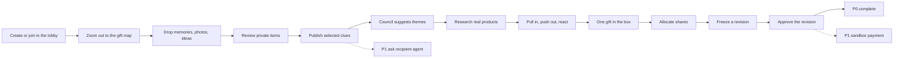

# Product

Unwrap is a collaborative gift studio. It turns what friends remember — and what a recipient is willing to share — into one gift the group can stand behind.

The original pitch in [PLAN.md](../PLAN.md) still holds. This document is the product spec for implementation. Scope, journeys, and exclusions here override the older “required MVP” list where they disagree. The important override: **P0 does not depend on sandbox payments or recipient-agent negotiation.**

## Vision

People already know the person they are buying for. That knowledge is fragmented. Unwrap makes the fragments inspectable, combines them without flattening them into a generic taste profile, and walks a group from memory → evidence → real options → one approved proposal.

Emotional promise: **you remembered something I said.**

Technical promise: recommendations cite confirmed clues and sourced listings; contribution math and approvals are deterministic.

## Target users

| User | Role in the product |
| --- | --- |
| Organizer | Creates the room, sets occasion / deadline / budget, can finalize selection |
| Contributor / buyer | Joins, chats, publishes clues, votes, sets a private cap, approves a revision |
| Solo buyer | The same person acting as organizer and only contributor |
| Recipient | Not a buyer. May later authorize a private preference profile for the recipient agent. Sees only an approved reveal if that flow is built |

Judges and demo recipients are not product users. Use synthetic, consented conversations in the demo.

## Primary journeys

P0 ends at a versioned, approved proposal (pledges, not charges). P1 features hang off that spine; they do not replace it.

## Group gifting

1. The app opens in the lobby, in front of the present. The organizer creates a room there: recipient display name, occasion, deadline, currency `USD`, optional budget ceiling.
2. Friends join by invite link or QR and wait in the lobby. Join grants room membership, not the right to read private imports or other people’s caps.
3. When the room is ready, the organizer starts it. The camera pulls back from the present and the gift map opens around it. **The gift map is the collaborative surface.** There is no tower step and no Backstage drawer on the main path.
4. Anyone clicks empty sky on the map to add a memory, a message, or an idea. A contributor may also paste selected text, import one supported text export, drop in up to three photos and tap to mark the recipient (P0), or drop up to three screenshots (P1-C). Imported items stay private, shown only to their contributor with an "only you" marker. Unwrap proposes typed clues with source IDs. The contributor corrects, discards, or publishes.
5. Published clues become room knowledge on the map's outer ring: interests, wishes, exclusions, ownership, timing, uncertain inferences.
6. The council suggests a few themes that group the published clues. Themes are suggestions; people can rename, merge, or dismiss them.
7. Research returns a bounded set of live listings (target 6–12 visible candidates). Each sits between the themes its recommendation cites.
8. The group steers by dragging: toward the box supports, away passes. "She has it" and "too pricey" are reactions on the node. One sharpen round may ask a single question and refine the leading ideas.
9. The organizer puts one or several gifts into the box at the center (up to 12 distinct products, one unit each).
10. Each person sets a private maximum from the box. Allocation is equal-split-capped, with remainder redistributed to people who still have capacity.
11. A proposal revision freezes every selected product, the combined estimate, and shares. Everyone approves that exact revision at the box.
12. If any selected gift, item observation, combined total, or share changes, approvals reset. The group looks at the new revision.

Two people in one room, updating live, is the minimum multiplayer bar.

## Solo experience

Solo is a room with one participant and the same buyer agent.

The solo buyer still reviews proposed clues before they become “confirmed” room knowledge. They still see sourced products on the same gift map. Contribution limits collapse to “I am funding this myself,” which still produces a revision so the later group path does not need a second model.

Do not build a separate solo chatbot.

## Evidence-backed personalization

Personalization is not a hidden embedding of the whole chat.

- Clues are typed and source-linked.
- A question or a quote about someone else does not silently become the recipient’s preference.
- Unpublished extraction stays with the contributor.
- “Why this?” highlights the published clues and the listing facts that support a recommendation.
- Personal exclusions outrank popularity.
- Trend signals, if added, are secondary and must cite a public source and observation window.

## Agent-assisted collaboration

The buyer agent is a facilitator on the shared map. It speaks through one notes line and through captions on the nodes it works on, not a separate chat panel. Its work shows as movement on the map: clues grouping into themes, listings growing between them, ideas fading or sharpening.

It should:

- Track interests, dislikes, and belongings that appear in room-visible or contributor-owned evidence
- Extract structured clues instead of writing essays
- Notice contradictions and outdated facts
- Ask a targeted follow-up when a missing slot blocks research
- Avoid re-asking answered questions
- Decide when to listen, wait, clarify, extract, search, or recommend
- Explain recommendations in terms of confirmed clues

It should not narrate every message, auto-publish clues, or treat its own guesses as confirmed preferences.

See [AI_AGENTS.md](AI_AGENTS.md).

## Recipient-agent participation (P1-A)

A second agent represents the recipient. It answers gift-shaped questions from the buyer agent using **recipient-authorized** preferences only.

Example of the intended conversation:

- Buyer agent: “Would a mechanical keyboard be suitable?”
- Recipient agent: “The recipient likes keyboards but already owns several. Desk accessories are a better direction.”
- Buyer agent: “What about a premium desk mat?”
- Recipient agent: “That matches an approved interest.”

This is a different consent flow from contributor-published clues. Publishing a clue in the buyer room never grants access to the recipient’s private messages or profile.

P0 can still record recipient preferences and exclusions **manually in the room** (as published clues). That is buyer-side knowledge, not recipient-agent knowledge.

## The gift map

The gift map is the room. It is laid out as rings around the present:

| Ring | Holds |
| --- | --- |
| Outer | Memories, messages, photos, and ideas friends share |
| Middle | Themes the council suggests, each covering a set of published clues |
| Inner | Gift ideas and sourced listings, placed between the themes they satisfy |
| Center | The box: the selected gift, shares, and approvals |

- Distance from the center shows how close an item is to the answer. Position around the circle shows what it is about.
- Dragging toward the box supports an item; dragging away passes. Every move is attributed and visible to everyone. Nothing is deleted by a pass.
- Layout is computed from room data. People do not arrange nodes by hand.
- Clicking a node opens a short row of actions under it. There are no popup panels or drawers.
- “Why this?” lights the path from the gift back through its themes to the clues behind it.

Mobile shows the same rings as a list with buttons for add, pull, pass, and put it in the box.

Keep the visible catalog small. One gift is a complete outcome. Do not build a marketplace or a multi-item cart.

## Budgeting and group approval

- One currency: `USD`.
- One selected gift at a time.
- Money stored as integer cents.
- Each participant has a private cap.
- Allocation is deterministic application code. Taste scores never authorize a share.
- A proposal is infeasible when capacity cannot cover the known payable total.
- Shipping and tax stay `unresolved` until a source provides them. Do not label an incomplete estimate as the final payable amount.
- Approvals bind to a revision ID. Changing product, quantity, total, or shares mints a new revision and invalidates old approvals.

P0 stops at pledged approvals. P1-B may attach sandbox authorizations to the same revision. See [COMMERCE_AND_PAYMENTS.md](COMMERCE_AND_PAYMENTS.md).

## Scope

### P0 — Core hackathon MVP

Must work end to end with two participants, no Stripe, and no recipient-agent network.

- Create and join rooms in the lobby, then zoom out to the gift map
- Live contribution updates on the map, with named cursors
- Buyer agent interprets gift-related information and proposes structured clues
- Source-aware clue review and selective publication
- Photo clues: drop 1–3 photos, mark the recipient, and review uncertain activity, style, setting, and ownership guesses (gated on the Phase 0 vision spike)
- Recipient preferences and exclusions as room-published clues
- One working external product source
- Product candidates with source links and observed prices
- Product photos on every card when the source provides one, with a clear placeholder when it does not
- The gift map in rings: published clues, themes, sourced listings, and the box (promoted from P2 in D19, [ARCHITECTURE.md](ARCHITECTURE.md)). If themes slip, listings sit on the inner ring by score.
- Steering on the map: pull in, push out, “she has it,” “too pricey,” and one sharpen round
- Private contribution limits
- Deterministic allocation
- Versioned proposal and explicit approvals
- Clear handling when the gift, total, or shares change

### P1 — Independently deliverable

**P1-A Agent-to-agent negotiation**

Buyer agent, recipient agent, structured protocol, approved-preference access, deterministic permission checks, refusal/unknown handling, recommendation integration.

**P1-B Sandbox payment orchestration**

Stripe test mode or a verified sponsor sandbox. Provider-hosted collection. Revision-specific authorization, capture, cancellation, idempotent events, failure and recovery, truthful status. Multi-contributor capture is **not** atomic.

If P1-B slips, keep pledges and optionally one organizer checkout. Never say a pledge is a charge.

**P1-C Screenshot clues**

A contributor uploads up to three screenshots of a chat, a social post, or a wishlist. A vision-capable model reads the visible text into private messages, then the normal extractor proposes clues from them. The contributor reviews and publishes exactly as with pasted text. The image itself is deleted after it is read. This is the strongest text-bearing input for the demo: “Jordan dropped in a screenshot, and Unwrap noticed Maya saved three wheel-throwing posts.” Photo clues (P0) are the scene-reading counterpart; screenshots are read for visible text only, never for scene guesses.

P1-C depends only on the P0 clue flow and a model that accepts images. It does not depend on P1-A or P1-B.

### P2 — Stretch and polish

Social/trend ranking, theme rename and merge, council characters walking the map, wrapping animation, extra product APIs, custom Apify Actors, Factory Droid, voice-note clues (record a short note, transcribe it into a private message, extract clues), other richer imports, recipient reveal, deeper personalization.

Sponsor integrations must do real work in the product. Stop adding them when the P0 demo is at risk.

### Explicit exclusions

- Always-on mailbox or messaging-account scrape
- Treating account OAuth as consent to analyze everything
- Multiple currencies or multi-item optimization
- Real money, escrow, or merchant order placement in P0
- Prompt-only privacy for the recipient agent
- An open product marketplace
- Voice, SMS, or email as required paths
- Claiming sandbox capture bought a real gift

## User-facing acceptance criteria

A teammate who was not in the architecture discussion should be able to:

1. Create a room in the lobby, join it from a second browser, start it, and land both browsers on the gift map.
2. From the map, paste a synthetic conversation, see proposed clues marked “only you,” publish two of them, and leave one unpublished.
3. Drop in a synthetic photo, tap to mark the recipient, see uncertain activity or style guesses appear for review, and publish one of them.
4. Watch the other participant see only the published clues and the shared memories — not the raw import, not any photo, and not private caps.
5. Get at least one live (or honestly timestamped) listing on the map with a product photo (or a visible “no photo from source” placeholder), a working source link, and an observed price.
6. Select the listing’s “Why this?” and see the themes and published clues that justify it.
7. Drag one gift into the box, set two different caps, and see shares recompute.
8. Approve a revision, change the gift or a cap, and watch the previous approvals become invalid.
9. Complete that path with no payment provider, no recipient agent, and no drawer or separate page.

## Differentiation

Existing tools already recommend gifts from a quiz, a chat, or a scraped profile. Unwrap’s difference is the *studio*: several people contributing evidence, an AI that has to show its work, a group that chooses together, and a proposal that dies when the deal changes.

If we also land a permission-bounded recipient agent or a recoverable sandbox payment, those deepen the story. They are not the definition of the product.

## Where to stop

If time gets tight, keep this spine and drop everything else:

**Lobby → map → published clues → sourced listings → one gift in the box → allocated proposal → revision-aware approvals.**

Drop in this order: trend ranking, voice notes, reveal animation, sharpen variants, the zoom animation (swap instantly), themes (listings by score instead), Factory/Droid, custom Actors, recipient agent, photo clues, screenshot clues, Stripe.

Do not drop source integrity, private caps, or approval invalidation to make room for a sponsor logo.

The buying screen supports one or multiple gifts through the same proposal flow.
Each product retains its observed price and source link. Unknown item prices block
funding; unknown shipping/tax stay visibly excluded from the estimate. Demo
contributions and wrapping are labelled simulation: no money charged or gifts
purchased. No automatic basket optimization or cross-retailer checkout is implied.
